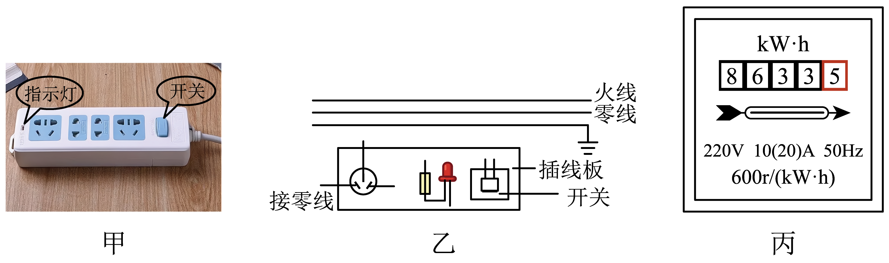

# Physics - 题目 282

**ID**: 3533eb24d7134719b1f557a387f1c4a6
**年级**: Grade 9
**难度**: Medium-Hard
**题型**: Comprehensive

## 题目
图甲是一个带开关和指示灯的三孔插座。​​​​​​​‌（1）小明发现当开关断开时指示灯不发光，插孔也不能提供工作电压；当开关闭合时指示灯发光，插孔可以提供工作电压；如果指示灯损坏，开关闭合时插孔也能提供工作电压。请在图乙中画出插座中的开关、指示灯（连限流电阻）和插孔的连接方式，并把插座与电源线接通；（2）已知普通煤的热值是3×107J/kg，水的比热容为4.2×103J/(kg•℃)，小明用煤炉将质量为1kg，初温为20℃的水烧到70℃消耗了20g的煤。则水吸收的热量为J，小明家煤炉的效率是。若用电磁炉代替煤炉，发现家中只有电磁炉工作10分钟时，如丙图所示家中的电能表圆盘转动了200转，则电磁炉的实际电功率为W。

## 解答

1. （1）[1]插线板上的指示灯在开关闭合时会发光，插孔正常通电，说明开关同时控制灯泡和插座，灯泡和插座之间可能是串联，也可能是并联，如果两者并联，开关应该在干路上；指示灯损坏，开关闭合时插孔也能正常通电，说明灯泡和插座之间是并联的，开关接在灯泡、插座和火线之间控制火线使用更安全。如图所示
2. 
3. （2）[2]水吸收的热量为
4. Q吸=cm(t-t0)=4.2×103J/(kg•℃)×1kg×(70℃-20℃)=2.1×105J
5. [3]煤的质量
6. m煤=20g=0.02kg
7. 煤完全燃烧放出的热量为
8. Q放=m煤q=0.02kg×3×107J/kg=6×105J
9. 小明家煤炉的效率为
10. ${\rm η＝\frac {Q{{}_{吸}}}{Q{{}_{放}}}\times 100{\rm{\%}}=\frac {2.1\times 10{^{5}}{\rm{J}}}{6\times 10{^{5}}{\rm{J}}}\times 100{\rm{\%}}=35{\rm{\%}}}$
11. [4]电能表上的600r/(kW•h)表示电路中用电器每消耗1kW•h电能，电能表的圆盘转过600r，当电能表圆盘转动了200转，电磁炉消耗的电能为
12. ${\rm W＝\frac {200r}{600{\rm{r}}/（{\rm{k}}{\rm{W}}•{\rm{h}}）}=\frac {1}{3}{\rm{k}}{\rm{W}}•{\rm{h}}}$
13. 电磁炉的实际电功率为
14. ${\rm P＝\frac {W}{t{{}_{1}}}=\frac {\frac {1}{3}{\rm{k}}{\rm{W}}•{\rm{h}}}{\frac {10}{60}{\rm{h}}}=2{\rm{k}}{\rm{W}}=2000{\rm{W}}}$

## 知识点

**中文**:
  - 热值及相关计算
  - 电能表的读数及电能的求解
  - 电与热综合计算

**English**:
  - Calorific Value and Calculations
  - Reading Energy Meters and Calculating Energy
  - Comprehensive Calculation of Electricity and Heat

---
