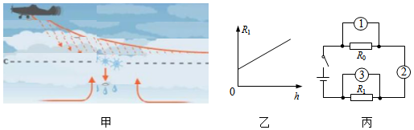

# Physics - 题目 509

**ID**: 3766be7a74c84a4fbf1b87a6be41e6a7
**年级**: Grade 9
**难度**: Medium-Hard
**题型**: Comprehensive

## 题目
阅读短文，回答问题。​​​​​​​‌2021年1月6日，我国拥有自主知识产权的人工影响天气无人机“甘霖- ${\rm {\rm{I}}}$ ”首飞成功，它具备远距离气象探测能力、大气数据采集能力、增雨催化剂播撒能力。甘霖- ${\rm {\rm{I}}}$ 人工影响天气项目是我国首次利用大型固定翼无人机开展人工影响天气工作，也是世界首创，是人工增雨（雪）工作的里程碑，标志着无人机在人工增雨（雪）工作中的技术和手段实现了突破，如图甲，无人机实施人工增雨雪的方式之一是将干冰“喷”入“冷云”，干冰会很快直接①成气态的二氧化碳，并从周围吸收大量的热，使空气的温度急剧下降，促使“冷云”里的水蒸气②成较大的雪花降落下来，如果地面气温较高，雪降落过程中边熔化边碰撞合并为水滴，最终成为降雨，这就是人工降雨。（1）从图甲中可以看出无人机机翼上凸下平，是利用流体流速大的地方，从而使飞机获得向上的升力；（2）请在文中① ② 两空填上物态变化名称：①；②；（3）飞机利用测距传感器来判断离地高度，若某测距传感器的阻值R_{1}与离地高度h的关系如图乙所示，图丙是检测电路（电源电压恒定，R_{0}为定值电阻），要使高度表（实质是电流表或电压表）的示数能随飞行高度的增大而增大，高度表应选用（选填“电流表”或“电压表”），且安装在（选填“1”、“2”或“3”）位置，判断依据是：。

## 解答

1. （1）[1]飞机的机翼上凸下平，空气在相等的时间内，空气经过上方比下方的路程长，上方比下方的空气速度大，上方比下方的压强小，产生了向上的升力作用。
2. （2）[2][3]人工降雨是飞机在高空投撒干冰，干冰进入冷云层，会迅速升华为气态的二氧化碳，升华会吸收大量的热，使空气的温度急剧下降，促使“冷云”里的水蒸气遇冷凝华成较大的雪花降落下来。
3. （3）[4][5][6]某测距传感器的阻值R_{1}与离地高度h的关系如图乙所示，从图乙可以看到，随着高度的增加，阻值R_{1}也在增大，而图丙中，电源电压恒定，R_{0}为定值电阻，阻值大小不变，1、3位置的表并联在电阻两端，那么1、3位置的表应该是电压表，2位置的表串联在电路中，那么2位置的表应该是电流表；题中要求，要使高度表的示数能随飞行高度的增大而增大，而高度的增加导致R_{1}阻值的增大，也导致了R_{1}两端电压的增大，R_{0}两端电压的减小，电流表示数的减小，所以高度表的示数是增大的，高度表应选用电压表，且安装在3位置。

## 知识点

**中文**:
  - 流体压强与流速的关系
  - 物态变化及其吸放热情况的判断与应用
  - 电流表的连接
  - 电压表的连接

**English**:
  - Relationship between Fluid Pressure and Flow Speed
  - Judgment and Application of State Changes and Heat Transfer
  - Connecting an Ammeter
  - Connecting a Voltmeter

---
