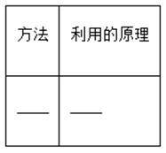

# Physics - 题目 2964

**ID**: 384309b932194763a6b9f99bc7e9cd6d
**年级**: Grade 9
**难度**: Medium-Hard
**题型**: Comprehensive

## 题目
综合开放题（1）“……每一次上班都要穿上严密的防护服、穿上不透风的隔离衣、戴帽子、N95口罩、护目镜和面屏，再戴四层橡胶手套．穿上这一身装备，对于我一个男的来说走起路来已经很笨重了，但也还能撑得过去，最大的障碍是，护目镜容易雾化，才戴上不到两分钟眼前已经是一片模糊，感觉一下子从5.2的视力变成一个上千度近视一样，就算把东西凑到面屏前面，看到的都是模糊的，我作为护士要给患者打针，视野不清晰对我的工作无疑造成很大影响……“上述是这次抗击疫情中一名护士的日记选摘，请你根据学过的物理知识提出一种防止护目镜雾化的方法（写出方法和原理）；（2）仿照下列示例写出一个物理学家及其主要贡献；示例：欧姆--电阻的单位--欧姆定律解答：（3）小兰在做早餐时发现，同样情况下，煮沸一锅牛奶要比煮沸同样多的水快，这是为什么呢？请你运用所学的物理知识，分析其中的原因，提出一个猜想，并简述验证猜想的方法：①你的猜想是：；②验证猜想的方法是：。​​​​​​​‌

## 解答

1. （1）[1][2]水蒸气遇冷会液化，形成小水滴，影响视线，给护目镜和面屏加热可防止水蒸气液化；护目镜和面屏温度越高，口腔呼出的水蒸气遇到护目镜和面屏越不容易液化，不会雾化。
2. （2）[3]物理学中有许多科学家的名字作单位，如牛顿--力的单位--牛顿第一定律，焦耳--功的单位--焦耳定律。
3. （3）[4][5]相同条件时，水和牛奶吸热，牛奶先沸腾，水后沸腾，可能与各自的沸点有关，可以通过测量沸腾时的温度进行比较。

## 知识点

**中文**:
  - 沸点及沸点与气压的关系
  - 液化及液化放热的特点
  - 物理常识及物理学史

**English**:
  - Boiling Point and Air Pressure
  - Liquefaction and Heat Release
  - General Physics Knowledge and History

---
