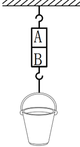

# Physics - 题目 2237

**ID**: 3d8848b2d49f45c08e6b967f3156f770
**年级**: Grade 9
**难度**: Medium-Hard
**题型**: Comprehensive

## 题目
为了说明分子之间有引力，小明在实验室用两个紧压在一起的铅柱做实验，如图所示，铅柱A和铅柱B所受的重力均为2N，两个铅柱接触面的面积为3cm^{2}，当悬挂重物所受的重力为20N时，两个铅柱没有被拉开。​​​​​​​‌于是，小明认为这个实验说明了分子之间存在引力。小华观测到该实验室的大气压为1×10^{5}Pa，于是她认为两个铅柱之所以没被拉开，是因为大气压的作用。请你利用所学知识和上述数据，判断小明做的铅柱实验能否说明分子之间存在引力。请写出计算、推理过程和结论。

## 解答

1. 解：把两个铅柱的底面削平、削净然后紧紧地压在一起，是为了两个铅柱之间没有空气，与铅柱底面接触的大气会对铅柱有向上托的力，这个力能否保证两个铅柱不被重物拉开。由公式 $p=\frac {F}{S}$ 得，铅柱横截面受到大气的压力，即对铅柱的托力为
2. $F=pS=1.0\times 10{^{5}}{\rm Pa}\times 3\times 10{^{-4}}{\rm m}{^{2}}=30{\rm N}$
3. 由于所挂重物的重力为20N，铅块重力为2N，总重力
4. $G{{}_{总}}=20{\rm N}+2{\rm N}=22{\rm N}$
5. 由于托力大于物体的总重力，所以小明做的铅柱实验不能说明分子之间存在引力。

## 知识点

**中文**:
  - 分子间的作用力
  - 大气压的应用

**English**:
  - Intermolecular Forces
  - Applications of Atmospheric Pressure

---
