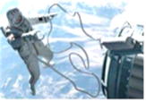

# Physics - 题目 1264

**ID**: 43ef7fcaea0c4a4eb8e0e9271177deb6
**年级**: Grade 9
**难度**: Medium-Hard
**题型**: Comprehensive

## 题目
如图所示，是航天员出舱时的英姿，请问：（1）出舱的航天员与轨道舱之间需要系上一根安全绳，当航天员意外“飘”离轨道舱时，可拉着绳子返回轨道舱，这是利用物体间的原理；​​​​​​​‌（2）航天员在完全失重的太空轨道舱中不能正常使用的测量工具是；

## 解答

1. （1）[1]物体间力的作用是相互的。航天员对绳子施加力的作用时，绳子会对航天员产生反作用力，所以航天员可以拉着绳子返回轨道舱。
2. （2）[2]A．用温度计测温度不受重力影响，可以正常使用，故A不符合题意；
3. B．天平是等臂杠杆，物体在完全失重的太空中，天平两边受到的压力为零，就无法进行测量，故B符合题意；
4. C．此时弹簧测力计不能测量物重，但是可以用来测拉力，所以能正常使用，故C不符合题意；
5. D．刻度尺测量物体的长度跟物体的重力没有关系，所以能正常使用，故D不符合题意。
6. 故选B。
7. （3）[3]吃一块净含量50g的上述巧克力获得的能量
8. $Q=\frac {2035{\rm{k}}{\rm{J}}}{100{\rm{g}}}\times 20{\rm{g}}=407{\rm{k}}{\rm{J}}=4.07\times 10{^{5}}{\rm{J}}$
9. [4]人类的活动需要的能量来自于食物的化学能，其中的一部分化学能转化为内能，以维持人体温度正常。

## 知识点

**中文**:
  - 力的作用是相互的
  - 热值及相关计算
  - 能量的转化

**English**:
  - Interaction of Forces
  - Calorific Value and Calculations
  - Transformation of Energy

---
