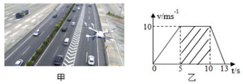

# Physics - 题目 1431

**ID**: 4a646aa052754a41a997edb4003aeffa
**年级**: Grade 9
**难度**: Medium-Hard
**题型**: Comprehensive

## 题目
无人机航拍影像具有高清晰、高实用性的优点。​​​​​​​‌如表是某小型无人机的部分参数：参数名称最大飞行半径km最大巡航速度km/h电池电压V电池容量mAh电动机额定功率W拍摄速度帧/秒数据5502425002011000（电池容量＝放电电流×放电时间，例如，1mAh是指以1mA的电流能连续工作1h。帧/秒是指每秒拍摄的画面数）。(1)人们是利用遥控器通过传输信息操控无人机的，其有效操控距离至少为km；(2)小轿车在高速公路上限速120km/h。如图甲所示，交警部门利用无人机进行高速公路通行情况的实时监测。一辆小轿车在通行0.5m的过程中，高速摄像机拍摄帧数为220帧，据此判断小轿车是否超速？（选填“是”或“否”）；(3)如图乙，是无人机竖直向上运动的v﹣t图象，由图象可知：阴影部分面积所表示的物理量的值为；(4)电动机是控制无人机飞行状态的关键动力设备，当它正常工作时，12s内消耗的电能是J。已知电动机消耗的能量是无人机电池储存最大能量的50%，则无人机在空中以额定功率飞行的时间不能超过h；(5)为增大小型无人机的巡航时间，制作无人机的材料应具有小的特点。

## 解答

1. (1)无人机与遥控器之间是通过电磁波来传递信息的。
2. 因为无人机的飞行半径为5km，则对它的有效控制距离至少为5km。
3. (2)相机拍摄速度为11000帧/秒，拍摄220帧用的时间为
4. $\frac {{\rm{2}}{\rm{2}}{\rm{0}}帧}{{\rm{1}}{\rm{1}}{\rm{0}}{\rm{0}}{\rm{0}}帧{\rm{/}}秒}{\rm{=}}{\rm{0}}{\rm{.}}{\rm{0}}{\rm{2}}秒$
5. 车的速度为
6. $v=\frac {s}{t}=\frac {0.5{\rm{m}}}{0.02{\rm{s}}}=25{\rm{m}}{\rm{/}}{\rm{s}}=90{\rm{k}}{\rm{m}}{\rm{/}}{\rm{h}}＜{\rm{1}}{\rm{2}}{\rm{0}}{\rm{k}}{\rm{m}}{\rm{/}}{\rm{h}}$
7. 所以不超速
8. (3)阴影部分为一长方形，其高为10m/s，长为
9. 10s－5s=5s
10. 所以，面积为
11. ${\rm{1}}{\rm{0}}{\rm{m}}{\rm{/}}{\rm{s}}\times {\rm{5}}{\rm{s}}{\rm{=}}{\rm{5}}{\rm{0}}{\rm{m}}$
12. (4)消耗的电能等于电流做的功，为
13. $W=Pt=20{\rm{W}}\times 12{\rm{s}}=240{\rm{J}}$
14. 无人机消耗的最大能量为
15. $W{{}_{机}}=W\times 50\%=UIt\times 50\%=24{\rm{V}}\times 2500{\rm{m}}{\rm{A}}\times 1{\rm{h}}\times 50\%=24{\rm{V}}\times 2.5{\rm{A}}\times 3600{\rm{s}}\times 50\%=1.08\times 10{^{5}}{\rm{J}}$
16. 消耗这些能量需要的时间为
17. $t{{}_{机}}=\frac {W{{}_{机}}}{P}{\rm{=}}\frac {1.08\times 10{^{5}}{\rm{J}}}{20{\rm{W}}}{\rm{=}}5400{\rm{s}}=1.5{\rm{h}}$
18. (5)为了增大巡航时间，要求无人机的重量小，在体积相同的条件下，就要求制作无人机的材料密度比较小一些。

## 知识点

**中文**:
  - 物质的物理属性
  - 速度的图像问题
  - 电功与电能的计算
  - 电功率与电能、时间的关系
  - 电磁波的传播与应用

**English**:
  - Physical Properties of Matter
  - Velocity-Time Graphs
  - Calculation of Electric Work and Energy
  - Power, Energy, and Time Relationship
  - Propagation and Application of Electromagnetic Waves

---
