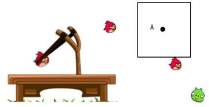
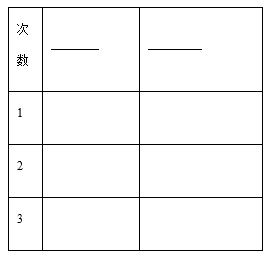

# Physics - 题目 1333

**ID**: 4b1e9a1e7094487e9cfdb830a04a2910
**年级**: Grade 9
**难度**: Medium-Hard
**题型**: Comprehensive

## 题目
游戏“愤怒的小鸟”深受同学们的喜爱，游戏其实就是像打弹弓一样，把“小鸟”对准怪物打过去。​​​​​​​‌（忽略空气阻力）（1）用A点表示小鸟，请在方框中画出小鸟刚离开橡皮筋时受力的示意图。（2）小鸟上升到最高点的过程中机械能（填“变小”、“变大”或“不变”）（3）弹弓的橡皮筋伸长过程中，弹性势能（选填“变小”、“变大”或“不变”）（4）乐于思考的小明同学在想，橡皮筋的弹性势能除了与橡皮筋的伸长量、材料有关，与橡皮筋自身长度、粗细是否有关？现有弹珠和弹弓各一个、相同材质、粗细不同的橡皮筋若干条、剪刀、刻度尺等，请你帮助小明设计实验步骤和补充完整实验表格，完成探究 “橡皮筋的弹性势能是否与自身长度有关”这一实验。实验步骤：

## 解答

1. （1）离开橡皮筋后，忽略空气阻力的情况下，小鸟只受重力，如图：
2. 
3. （2）由于忽略空气阻力，仅受重力的情况下，小鸟在空中的机械能守恒，小鸟上升到最高点的过程中机械能不变。
4. （3）弹性势能的大小是随着橡皮筋的伸长量的增大而增大的，因此弹性势能变大。
5. （4）步骤：①用剪刀将1条橡皮筋剪成长度不等的三段；并用刻度尺量出橡皮筋的长度。
6. ②依次将这三段橡皮筋固定在弹弓上，在弹性限度范围内，拉伸相同的伸长量，将弹珠在同一位置沿水平方向弹射出去，测得弹珠弹射的水平距离。
7. 实验表格如下
8. 次数
9. 橡皮条长/cm
10. 弹射的水平距离/m
11. 1
12. 2
13. 3

## 知识点

**中文**:
  - 弹性势能的变化问题
  - 重力示意图
  - 机械能的变化问题

**English**:
  - Changes in Elastic Potential Energy
  - Gravity Diagrams
  - Changes in Mechanical Energy

---
