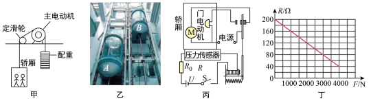

# Physics - 题目 2061

**ID**: 4e4586bc2b964ccb9c612693e4b8b345
**年级**: Grade 9
**难度**: Medium-Hard
**题型**: Comprehensive

## 题目
阅读短文，回答问题：观光电梯电梯是一种用于多层建筑乘人或载物的运输工具。​​​​​​​‌电梯的简易结构如图甲所示，电梯轿厢和配重分别挂在主电动机的两侧，在电梯半载时，轿厢总重和配重的重力基本相等。满载上升时，主电动机提供动力，驱动轿厢。如图乙所示，为某商业大厦安装的观光电梯，其相关参数如下表。为了安全，电梯设置了超载自动报警系统，其工作原理如图丙所示，控制电路的电源电压U为12V，压力传感器的电阻R与所受压力F的关系图像如图丁所示，电磁继电器阻值可忽略。当电流大于0.2A时，会启动警报系统，同时无论如何按压电梯控制器，门电动机均不工作。此外，电梯需经常保养，“运行频次比ω”是电梯养护的重要指标，ω一般用电梯每天平均待机时间与运行时间之比来表示。额定电压/V220额定运动功率/kW25待机功率/kW1最大载重/N4000轿厢质量/kg500（1）定滑轮的作用是，主电机与钢丝绳之间的摩擦为摩擦；（选填“有害”或“有益”）（2）超载自动报警系统中电磁铁的右端为极；（3）乙图中，当站在地面上的人看到B电梯和A电梯在上升，而站在B电梯里的乘客却看到A电梯在下降，则说明A电梯的速度（大于/小于/等于）B电梯的速度；（4）该观光电梯配重的重力约为N；控制电路中R_{0}=Ω；（5）该商业大厦每天营业时间为12h，设电梯均在额定功率下运行；经测算，该观光电梯平均每天耗电60kW•h，则该观光电梯的“运行频次比”ω=。

## 解答

1. （1）[1]定滑轮的实质是一个等臂杠杆，不省力，但可改变力的方向，所以定滑轮的作用是改变力的方向。
2. [2]主电机与钢丝绳之间的摩擦使钢丝绳上升，该摩擦属于有益摩擦。
3. （2）[3]根据安培定则可判断超载自动报警系统中电磁铁的右端为N极。
4. （3）[4]站在地面上的人看到B电梯和A电梯在上升，当站在上升的B电梯里的乘客看到A电梯在下降，说明A的上升速度小于B电梯上升的速度。
5. （4）[5] 已知轿厢质量为500kg，轿厢的重
6. G_{轿厢}＝mg＝500kg×10N/kg＝5000N
7. 电梯半载时
8. G_{半载}＝ $\frac {1}{2}$G_{最大}＝ $\frac {1}{2}$ ×4000N＝2000N
9. 已知在电梯半载时，轿厢总重和配重的重力基本相等，配重的重力
10. G_{配}＝G轿厢+G_{半载}＝5000N+2000N＝7000N
11. [6]当电梯刚好满载时，即压力传感器所受压力
12. F＝G_{最大}＝4000N
13. 由图丁可知，压力传感器的电阻
14. R＝40Ω
15. 由欧姆定律得，电路总电阻
16. $R{{}_{总}}=\frac {U}{I}=\frac {12{\rm{V}}}{0.2{\rm{A}}}=60Ω$
17. 根据串联电路电阻特点可知，R_{0}的阻值
18. R_{0}＝R_{总}﹣R＝60 $Ω$ ﹣40 $Ω$ ＝20 $Ω$
19. （5）[7]电梯运行消耗的电能
20. W_{运行}＝P额t_{运行}＝25kW×t运行
21. 电梯待机消耗的电能
22. W_{待机}＝P待机t_{待机}＝1kW×t待机
23. 则电梯平均每天消耗的电能
24. W＝W运行+W待机
25. 即
26. 25kW×t运行+1kW×t_{待机}＝60kW•h①
27. 已知该商业大厦每天营业时间为12h，故有
28. t运行+t_{待机}＝12h②
29. 由①②可解得
30. t_{运行}＝2h
31. t_{待机}＝10h
32. 则该观光电梯的“运行频次比”
33. $ω=\frac {t{{}_{待机}}}{t{{}_{运行}}}=\frac {10{\rm{h}}}{2{\rm{h}}}=5$

## 知识点

**中文**:
  - 电磁继电器的常见应用
  - 运动和静止的相对性
  - 电磁继电器的构造及原理

**English**:
  - Common Applications of Electromagnetic Relays
  - Relativity of Motion and Rest
  - Structure and Principle of Electromagnetic Relays

---
