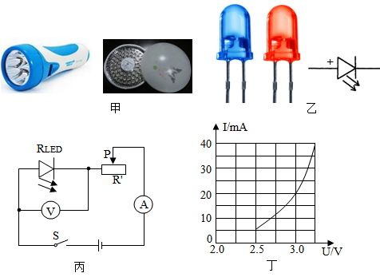

# Physics - 题目 1065

**ID**: 5965197887434512be50530079701d88
**年级**: Grade 9
**难度**: Medium-Hard
**题型**: Comprehensive

## 题目
阅读短文，回答问题。​​​​​​​‌第四代电光源——LED光源如图甲是时下较为流行的LED手电筒和LED吸顶灯，它的主要部分是高亮度白色发光二极管，这种发光二极管主要由硅、砷等半导体材料制成，具有光效高耗电少、寿命长、易控制、免维护、安全环保等优点，是继白炽灯、卤素灯和节能荧光灯后新兴的第四代电光源，是极具发展前途的新光源。LED的发光原理与白炽灯先发热后发光的原理截然不同，是直接把电能转换成光能的器件，因而其发光效率较高，是新一代固体冷光源，将逐步取代传统光源。图乙是LED的元件实物及符号。由于二极管具有单向导电性，使用时必须将它的正极与电源正极相连，二极管才能处于导通状态，否则处于截止状态。利用图丙所示电路可以研究发光二极管的工作特性：把一个额定电压为3V的LED接入电源电压恒为4.5V的电路，闭合开关S，LED即处于导通状态，调节变阻器滑片改变LED两端的电压和电路中的电流，记录多组电压、电流数据，可以得到电压表与电流表的示数关系，如图丁所示。(1)LED灯主要由（选填“导体”“半导体”或“超导体”）材料制成；它之所以节能，被称为冷光源，是因为电热转换损耗的能量较白炽灯（选填“高”或“低”）；(2)在图丙中，闭合开关S，调节滑动变阻器的滑片，使LED正常发光，此时电流表的示数为。断开S，对调电源的正负极后再闭合S，LED（选填“能”或“不能”）发光；(3)某个家庭原来全部用白炽灯来照明，平均每月照明用电50kW·h，现全部改用LED灯。相同情况下可节能约70%。已知每消耗1度电相当于排入1.1kg的二氧化碳，则改用LED灯后，这个家庭平均每月比原来减少排放二氧化碳约kg。

## 解答

1. (1)由材料可知，二极管是由半导体做成的器件。发光二极管主要由硅、砷等半导体材料制成，具有光效高、耗电少、寿命长、易控制、免维护、安全环保等优点，所以LED灯主要由半导体材料制成。LED灯称为冷光源，是因为电热转换损耗的能量较白炽灯低。
2. (2)闭合开关S，LED正常发光，由图丁可知，当U=3V时，I=20mA；断开S，改变电源的正负极后闭合S，由于LED具有单向导电性，所以电路处于断路状态，LED不能发光。
3. (3)全部改用LED灯后节约电能
4. ΔE=50kW·h×70%=35kW·h
5. 可比原来减少排放二氧化碳
6. Δm=ΔE× 1.1 kg/(kW·h)=35 kW·h×1.1kg/(kW·h)=38.5 kg

## 知识点

**中文**:
  - 半导体的特点与应用
  - 欧姆定律的应用

**English**:
  - Characteristics and Applications of Semiconductors
  - Applications of Ohm's Law

---
