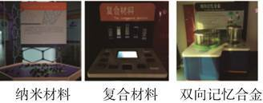

# Physics - 题目 1357

**ID**: 5e3f25e7101042b0afd3b146520a4176
**年级**: Grade 9
**难度**: Medium-Hard
**题型**: Comprehensive

## 题目
阅读《新型材料》，回答问题。​​​​​​​‌《新型材料》如图所示是科技馆内展示的新型材料：纳米材料、复合材料和双向记忆合金。纳米材料是指由颗粒尺寸在1~100nm之间的超微颗粒组成的材料，纳米是一个极小的长度单位，当材料颗粒小至纳米级别时，会赋予该材料很多特有的性质，是普通材料无法比拟的。复合材料是两种或两种以上不同性质的材料，通过物理或化学的方法，在宏观（微观）上组成具有新性能的材料。从古至今沿用的稻草增强粘土和已使用上百年的钢筋混凝土均由两种材料复合而成，也是复合材料。由于复合材料的重量轻、强度高、加工成型快、耐腐蚀性能好等特点，不仅广泛应用于汽车、健身器材、建筑、家居等方面。随着现代科技的发展，复合材料在航空工业上也起到十分重要的作用。用酒精灯给双金属片加热，双金属片发生弯曲，原来这个受热弯曲的金属片是由两种不同的金属贴合而成的，各种金属都有热胀冷缩的特性，而不同的金属随着温度变化热胀冷缩的程度不同，金属片于是就会发生弯曲，例如铁片和铜片组成的双金属片，铜片的膨胀系数比铁片大，温度高时，膨胀得比铁片多，就会弯曲，双金属片的这种性质在生活中有很多应用。（1）纳米材料是指由颗粒尺寸在之间的超微颗粒组成的材料；（2）复合材料广泛应用于汽车、健身器材、建筑、家居等方面，主要因为复合材料的特点；（3）给双金属片加热双金属片发生弯曲，这主要是利用了的特性。

## 解答

1. （2）[2]由于复合材料的重量轻、强度高、加工成型快、耐腐蚀性能好等特点，不仅广泛应用于汽车、健身器材、建筑、家居等方面，随着现代科技的发展，复合材料在航空工业上也起到十分重要的作用。
2. （3）[3]铁片和铜片组成的双金属片，铜片的膨胀系数比铁片大，温度高时，膨胀得比铁片多，就会弯曲，双金属片的这种热胀冷缩的性质在生活中有很多应用。

## 知识点

**中文**:
  - 物质的物理属性

**English**:
  - Physical Properties of Matter

---
