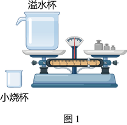
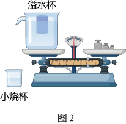

# Physics - 题目 1505

**ID**: 5eddc51f70084511b16490dcfe9f83bb
**年级**: Grade 9
**难度**: Medium-Hard
**题型**: Comprehensive

## 题目
小明学习了阿基米德原理后对浮力非常感兴趣，他做了如下实验：将溢水杯装满水，放到天平左盘上，将天平调节平衡如图1。​​​​​​​‌接下来将一个小木块（不吸水）轻轻放到溢水杯中，用小烧杯接好溢出的水。（ $ρ{{}_{水}}=10{^{3}}kg/m{^{3}}$ ，g=10N/kg）（1）等小木块静止后，图2天平的指针将会：（选填“向左偏”、“向右偏”、“指向中间”）（2）经过测量，小烧杯中的水的体积为50cm^{3}，求小木块的重力。()（3）小木块的底面积为10cm^{2}，求其下表面受到的压强。()

## 解答

1. 解：（1）因为木块漂浮，由阿基米德原理可知，小木块排开液体的重力等于小木块受到的浮力、等于小木块的重力，即流出的水的质量等于小木块的质量，所以等小木块静止后，图2天平的指针将会指向中间。
2. （2）排开水的体积
3. V=50cm^{3}=5 $\times $ 10^{-5}m^{3}
4. 由 $ρ=\frac {m}{V}$ 得
5. m=ρv=1 $\times $ 10^{3}kg/m^{3}$\times $ 5 $\times $ 10^{-5}m^{3}=5 $\times $ 10^{-2}kg
6. 因为木块漂浮，所以
7. G=F_{浮}=G_{排}=mg=5 $\times $ 10^{-2}kg $\times $ 10N/kg=0.5N
8. （3）木块浸入水中的深度
9. $h=\frac {V}{S}=\frac {50{\rm cm}{^{3}}}{10{\rm cm}{^{2}}}=5{\rm cm}=0.05{\rm m}$
10. 其下表面受到的压强
11. P=ρgh=1 $\times $ 10^{3}kg/m^{3}$\times $ 10N/kg $\times $ 0.05m=500pa
12. 答：（2）小木块的重力为0.5N；
13. （3）其下表面受到的压强为500pa。

## 知识点

**中文**:
  - 液体压强的大小及其计算
  - 阿基米德原理的应用
  - 物体的浮沉条件及其应用

**English**:
  - Magnitude and Calculation of Liquid Pressure
  - Applications of Archimedes' Principle
  - Floating/Sinking Conditions and Applications

---
