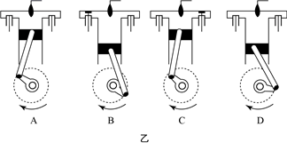

# Physics - 题目 1076

**ID**: 65c8a36ad2a74f678d4e30c39f613b30
**年级**: Grade 9
**难度**: Medium-Hard
**题型**: Comprehensive

## 题目
混合动力汽车的燃油经济性能高，而且行驶性能优越。​​​​​​​‌混合动力汽车启动时，内燃机并不工作，蓄电池通过某种方式向车轮输送能量；当需要高速行驶或蓄电池储存电能过低时，内燃机启动，既可以向车轮输送能量，也可以同时给蓄电池充电；当车辆需要全力加速时，内燃机和蓄电池还可以同时向车轮输送能量，简单地说，就是与同样大小的汽车相比，燃油费用更低。小明家新进购置了一台某品牌的混合动力汽车，如图甲所示，小明结合课堂上学到的物理知识对该汽车进行了细致的研究。(1)通常所说的混合动力汽车，一般是指油电混合动力汽车（Hybrid Electric Vehicle，HEV），即采用传统的内燃机（柴油机或汽油机）和电动机作为动力源。图乙为四冲程内燃机的各冲程的示意图，一个工作循环合理的顺序应为（填字母）。(2)车上装有一个用来提醒司机是否关好车门的指示灯。四个车门中只要有一个门没关好（相当于一个开关断开），该指示灯就会发光。如图丙所示的模拟电路图符合要求的是。(3)汽车中有如图丁所示的电路，其中上端带金属细杆的金属滑块M与两侧金属弹簧相连接并接入电路中，金属滑块M与弹簧套在光滑绝缘的水平细杆上，当汽车静止时，滑块M上的金属细杆与红、绿灯一端的触头（图中箭头）都不接触，当汽车向前启动时，灯亮；当汽车急剃车时，灯亮（均填“红”或“绿”）。(4)在某次出行的过程中，在水平道路上匀速行驶170km，共消耗汽油10L，水平道路的平均阻力为1000N，若该汽车内燃机的效率为53%，则此过程中牵引力所做的功为J，最终使蓄电池电能增加电能J。（忽略蓄电池和电动机的热损失，ρ_{汽油}=0.7×10^{3}kg/m^{3}，q_{汽油}=4.6×10^{7}J/kg）

## 解答

1. (1)[1]热机的四个冲程包括吸气冲程、压缩冲程、做功冲程、排气冲程，A图中的两个气阀都关闭，活塞向上运动，为压缩冲程，是第二冲程；B图中的一个气阀打开，活塞向下运动，为吸气冲程，是第一冲程；C图中的一个气阀打开，活塞向上运动，为排气冲程，是第四冲程；D图中的两个气阀都关闭，活塞向下运动，所以为做功冲程，是第三冲程；则一个工作循环合理的顺序应为BADC。
2. (2)[2]四个车门中只要有一个门没关好（相当于一个开关断开），该指示灯就会发光，说明开关串联后整体再与灯泡并联，所有开关闭合后灯泡才被短路不发光，所示的模拟电路图符合要求的是B。
3. (3)[3][4]汽车中有如图丁所示的电路，其中上端带金属细杆的金属滑块M与两侧金属弹簧相连接并接入电路中，金属滑块M与弹簧套在光滑绝缘的水平细杆上，当汽车静止时，滑块M上的金属细杆与红、绿灯一端的触头（图中箭头）都不接触，当汽车向前启动时，金属滑块M具有惯性保持静止，压缩后弹簧，此时绿灯接入电路发亮；当汽车急剃车时，金属滑块M具有惯性继续保持运动，压缩前弹簧，此时红灯接入电路发亮。
4. (4)[5]内燃机既向车轮提供能量，又向蓄电池充电，同时蓄电池又将部分能量通过电动机向车轮输送；根据二力平衡条件，在水平道路上匀速行驶时牵引力大小等于阻力，则牵引力做功为
5. 
6. [6]匀速行驶过程中，消耗汽油的质量为
7. 
8. 汽油燃烧放出的热量为
9. 
10. 汽车内燃机的效率为53%，则内燃机输出的有用能量为
11. 
12. 最终使蓄电池电能增加电能为
13. 

## 知识点

**中文**:
  - 串、并联电路的设计
  - 密度公式的应用
  - 功的计算和估算
  - 热值及相关计算
  - 内燃机的四个冲程

**English**:
  - Designing Series and Parallel Circuits
  - Application of Density Formula
  - Calculation and Estimation of Work
  - Calorific Value and Calculations
  - Four Strokes of Internal Combustion Engines

---
