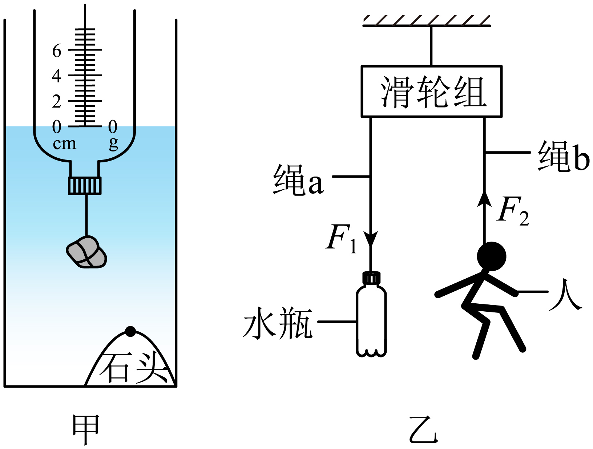
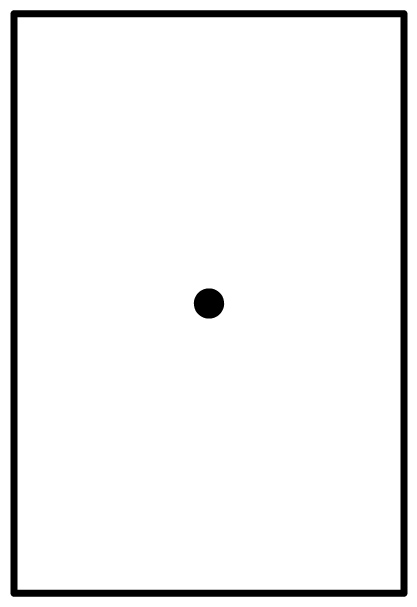

# Physics - 题目 924

**ID**: 690de09a474a42449be578bf8651e8ea
**年级**: Grade 9
**难度**: Medium-Hard
**题型**: Comprehensive

## 题目
某科技小组的同学想制作一个简易浮力秤来测质量。​​​​​​​‌他们剪掉空塑料瓶的瓶底，旋紧瓶盖，在瓶盖上系一块质量适当的石块，然后将其倒置在水桶里，水桶里面水深h_{1}=80cm，当瓶中不放被测物体静止时，在瓶上与水面相平位置标记为零刻度线，再在瓶身上均匀标记其他刻度线，左侧标记的是长度值，若在刻度线右侧标上相应的质量值，即可做成一个简易浮力秤，如图甲所示。已知零刻度线以上瓶身粗细均匀，其横截面积为 50cm^{2}，不放被测物体时浮力秤的总质量为170g，水的密度为 1.0×10^{3}kg/m^{3}，g取10N/ kg。（1）请在方框内画出图中浮力秤的受力示意图（用“·”来表示浮力称）。（2）水桶底部有一块石头，已知石头上的A点距离水桶底部h_{2}=15cm，求A点处所受水的压强为多少?（3）求图中所示状态浮力秤受到的浮力。（4）求浮力秤上2cm刻度线对应的质量值。（5）科技小组的同学又拿着水瓶用滑轮组进行“一瓶水提升一个人”活动，如图乙，水瓶匀速直线下降10m，使人匀速升高0.5m，水瓶对绳a的拉力为F_{1}=30N，绳b对人的拉力为F_{2}=480N。此过程①F_{1}做的功F_{2}做的功（选填“>”“=”“<”）；②使用该滑轮组是（选填“省力”“费力”或“不省力也不费力”）；③请分别求出该滑轮组的有用功和机械效率?、

## 解答

1. （1）浮力秤漂浮时，浮力等于重力，都画在重心上，浮力方向竖直向上，重力方向竖直向下。
2. （2）A点处所处深度  $h{{}_{{\rm{A}}}}=h{{}_{1}}-h{{}_{2}}=80{\rm{c}}{\rm{m}}-15{\rm{c}}{\rm{m}}=6{{5}}{\rm{c}}{\rm{m}}{\rm{=}}{{0}}{{.}}{{6}}{{5}}{\rm{m}}$
3. A点处压强为 $p=ρ{{}_{水}}gh{{}_{{\rm{A}}}}=1.0\times 10{^{3}}{\rm{k}}{\rm{g}}{\rm{/}}{\rm{m}}{^{3}}\times 10{\rm{N}}{\rm{/}}{\rm{k}}{\rm{g}}\times 0.65{\rm{m}}=6.5\times 10{^{3}}{\rm{P}}{\rm{a}}$
4. （3）浮力秤漂浮，浮力秤受到的浮力 $F{{}_{浮}}=G{{}_{秤}}=m{{}_{秤}}g=0.17{\rm{k}}{\rm{g}}\times 1{{0}}{\rm{N}}{\rm{/}}{\rm{k}}{\rm{g}}{\rm{=}}{{1}}{{.}}{{7}}{\rm{N}}$
5. （4）浮力秤浸到2cm刻度线漂浮时，秤内放入被测物的质量为m_{测}，依据漂浮时受力平衡条件，不放入被测物时F_{浮}=G_{秤}
6. 放入被测物时F_{浮}'=G_{秤}+m_{测}g
7. 可知m_{测}g=F_{浮}'-F_{浮}
8. 依据阿基米德原理F_{浮}=ρ_{水}gV_{0}
9. 则F_{浮}'=ρ_{水}gV_{0}+ρ_{水}gΔV_{排}
10. 则有m_{测}=ρ_{水}ΔV_{排}=ρ_{水}SΔh=1.0g/cm^{3}×50cm^{3}×2cm=100g
11. （5）①克服人的重力所做的功为有用功，绳b对人的拉力为F_{2}=480N，所以人的重力G=F_{2}=480N
12. 有用功W_{有}=Gh=480N×0.5m=240J
13. F_{1}做的功为总功，总功大小为W_{总}=F_{1}h_{瓶}=30N×10m=300J>240J
14. 所以F_{1}做的功大于F_{2}做的功。
15. ②水瓶对绳a的拉力为F_{1}=30N，绳b对人的拉力为F_{2}=480N，由于F_{1}<F_{2}
16. 所以该滑轮组是省力。
17. ③有用功W_{有}=Gh=480N×0.5m=240J
18. 机械效率 $η=\frac {W{{}_{有}}}{W{{}_{总}}}\times 100\%=\frac {240{\rm{J}}}{300{\rm{J}}}\times 100\%=80\%$

## 知识点

**中文**:
  - 力的示意图与图示
  - 液体压强的大小及其计算
  - 阿基米德原理的应用
  - 物体的浮沉条件及其应用
  - 滑轮组及其工作特点
  - 有用功、额外功和总功的计算
  - 滑轮（组）的机械效率及其计算

**English**:
  - Force Diagrams
  - Magnitude and Calculation of Liquid Pressure
  - Applications of Archimedes' Principle
  - Floating/Sinking Conditions and Applications
  - Pulley Systems and Operating Characteristics
  - Calculation of Useful, Extra, and Total Work
  - Mechanical Efficiency of Pulleys and Calculations

---
