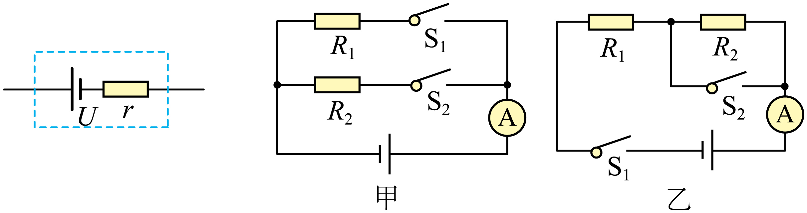

# Physics - 题目 2989

**ID**: 6b12c32ef9a240f7a91d95c8fca2ac4e
**年级**: Grade 9
**难度**: Medium-Hard
**题型**: Comprehensive

## 题目
实际的电源都有一定的内部电阻r。​​​​​​​‌如干电池，因其内阻r的存在，对外供电时所提供的电压也不是它本身的真正电压，实际计算过程中，可以把它看成是由一个电压为U、电阻为0的理想电源与一个阻值为r的电阻串联而成，如图所示。实验室有一电压约为3V的电源（内阻不到1 ${\rm{Ω}}$ ）。为了测量该电源的内阻r，现有两个电阻R_{1}=15Ω，R_{2}=5Ω，一个量程为0~0.3A的电流表，并设计了图中甲、乙两种测量电路，请通过分析回答下列问题；（1）你认为能够测电源内阻的电路是（选填“甲”或“乙”）：（2）写出主要实验步骤和需测量的物理量；（3）写出电源内阻r的数学表达式（用己知量和测量值表示）。

## 解答

1. （1）如图甲所示，两个电阻R_{1}、R₂并联，当闭合开关S_{2}时，电阻R_{2}与电源的内阻r串联，电路中的电流为 $I=\frac {U}{R{{}_{2}}+r}=\frac {3{\rm{V}}}{5{\rm{Ω}}+1{\rm{Ω}}}=0.5{\rm{A}}{\rm{>}}0.3{\rm{A}}$ ，因为通过的电流大于电流表量程，此方案不可行；所以能够测电源内阻的电路是乙。
2. （2）如图乙所示，实验步骤：①闭合开关S_{1}、S_{2}，读出电流表示数为I_{1}；②闭合开关S_{1}，断开开关S_{2}读出电流表示数为I_{2}。
3. （3）因电源电压不变，则关系式为 $U=I{{}_{1}}\left ({R{{}_{1}}+r}\right )=I{{}_{2}}\left ({R{{}_{1}}+R{{}_{2}}+r}\right )$ ，电源内阻r的数学表达式为 $r=\frac {I{{}_{2}}\left ({R{{}_{1}}+R{{}_{2}}}\right )-I{{}_{1}}R{{}_{1}}}{I{{}_{1}}-I{{}_{2}}}=\frac {I{{}_{2}}\left ({15{\rm{Ω}}+5{\rm{Ω}}}\right )-I{{}_{1}}15{\rm{Ω}}}{I{{}_{1}}-I{{}_{2}}}=\frac {20I{{}_{2}}-15I{{}_{1}}}{I{{}_{1}}-I{{}_{2}}}{\rm{Ω}}$

## 知识点

**中文**:
  - 其他方法测电阻

**English**:
  - Other Methods for Measuring Resistance

---
