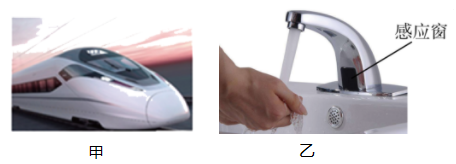
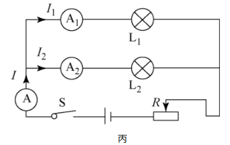

# Physics - 题目 717

**ID**: 6f2fb7970d0a442094ced1e553587cea
**年级**: Grade 9
**难度**: Medium-Hard
**题型**: Comprehensive

## 题目
随着赣州高铁的开通，大大的提升了我市居民出行的条件。​​​​​​​‌假期期间，小叶与同事乘坐高铁外出旅游，爱观察的他们发现了高铁上许多与物理有关的知识。(1)高铁的车头设计成如图甲所示的子弹头型，目的是减小；如图乙是车上的红外线感应水龙头，感应窗发出的红外线照到手上发生了光的现象，使感应窗内的红外线接收管收到信号后控制出水。(2)列车进站前要提前刹车，这是因为列车刹车后由于，还要再继续运动一段距离；乘坐高铁时，感觉比普通列车噪声要小很多，车内采用了很多降低噪声的技术，如安装中空玻璃，利用了在中减弱噪声的原理。(3)通过隧道时，每个车厢的照明灯都会亮起来，而且亮度相同。他们想：车厢内的照明灯是并联的，并联电路中的电流有什么规律呢？小叶设计了如图丙所示的电路，通过实验，得到的数据如表所示∶电流第1次第2次第3次第4次I_{1}/A0.180.220.241.4I_{2}/A0.180.220.240.28I_{3}/A0.360.440.480.56①小叶分析数据时发现，表格中有一个错误数据是，请指出错误的原因。②改正错误后，小青与同学交流，她发现实验设计中还存在不足之处，请指出。(写出一条即可)

## 解答

1. (1)高铁的车头设计成如图甲所示的子弹头型，目的是为了减小空气阻力。
2. 车上的红外线感应水龙头，使用时，感应窗发出的红外线照到手上发生了光的反射现象，使感应窗内的红外线接收管接收到信号后控制出水。
3. (2)列车进站前要提前刹车，这是因为列车刹车后由于惯性，还要继续运动一段距离。
4. 乘坐高铁时，感觉比普通列车噪声小很多。车内采用了很多降低噪声的技术，如安装中空玻璃，利用了在传播过程中减弱噪声的道理。
5. (3)①并联电路干路中的总电流等于各支路电流之和，因为灯的亮度相同，流经各支路的电流相同，故表格中有一个错误数据是第4次实验数据中的1.4，因为电流表大量程是小量程的5倍，错误的原因读错了电流表的量程。
6. ②实验应该换用不同规格的灯泡进行多次实验，避免实验的偶然性和巧合，所以实验设计中还存在不足之处是：用的灯泡的规格是相同的。

## 知识点

**中文**:
  - 探究串、并联电路的电流规律实验
  - 防治噪声的途径
  - 红外线的特点及应用
  - 生活中的惯性现象

**English**:
  - Experiment: Current Laws in Series/Parallel
  - Methods of Noise Control
  - Characteristics and Applications of Infrared
  - Inertia Phenomena in Daily Life

---
