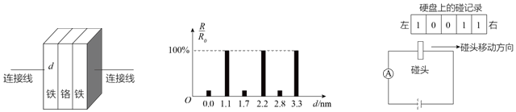

# Physics - 题目 2328

**ID**: 6fcf343b806447efa1afc65d72ecf6f1
**年级**: Grade 9
**难度**: Medium-Hard
**题型**: Comprehensive

## 题目
阅读短文，回答问题：巨磁电阻效应1988年阿尔贝•费尔和彼得•格林贝格尔发现，在铁、铬相间的三层复合膜电阻中，微弱的磁场可以导致电阻大小的急剧变化，这种现象被命名为“巨磁电阻效应”。​​​​​​​‌更多的实验发现，并非任意两种不同种金属相间的膜都具有“巨磁电阻效应”。组成三层膜的两种金属中，有一种是铁、钴、镍这三种容易被磁化的金属中的一种，另一种是不易被磁化的其他金属，才可能产生“巨磁电阻效应”。进一步研究表明，“巨磁电阻效应”只发生在膜层的厚度为特定值时。用R_{0}表示未加磁场时的电阻，R表示加入磁场后的电阻，科学家测得铁、铬组成的复含膜R与R_{0}之比与膜睽厚度d（三层膜厚度均相同）的关系如图所示。1994年IBM公司根据“巨磁电阻效应”原理，研制出“新型读出磁头”，将磁场对复合膜阻值的影响转换成电流的变化来读取信息。(1)以下两种金属组成的三层复合膜可能发生“巨磁电阻效应”的是；

## 解答

1. (1)[1]由题意知，组成层膜的两种金属有一种是易磁化的金属铁钴镍中的其中一种，另一种是不易被磁化的，故选B。
2. (2)[2]由图知：当d＝1.7nm时， $\frac {R}{R{{}_{0}}}$ 远小于1，即在施加磁场前后，复合膜的阻值变化较大，符合“巨磁电阻效应”，即此时复合膜具有“巨磁电阻效应”。
3. (3)[3][4]“新型读出磁头”将磁场对复合膜阻值的影响转化为电流，即将磁场的变化（磁信息）转化电流的变化（电信息）该转化过程是利用电磁感应原理。
4. (4)[5]同(2)，由图知：当复合膜发生“巨磁电阻效应”时， $\frac {R}{R{{}_{0}}}＜1$ ，即
5. R＜R_{0}
6. 因此电阻R要比R_{0}小的多。
7. (5)[6]在“硬盘的磁信息”中，左数第一、四、五格均为有磁区域，由“巨磁电阻效应”知，此时电阻要变小，相应的电流要变大；而左数第二、三格为无磁区域，电阻没有变化，电流较小；根据上面的分析知，只有B图符合上述要求，故选B。
8. 【点睛】
9. 本题为信息给予题，要学会从众多文字中寻找答案的能力。

## 知识点

**中文**:
  - 电磁感应现象
  - 磁性材料

**English**:
  - Electromagnetic Induction
  - Magnetic Materials

---
