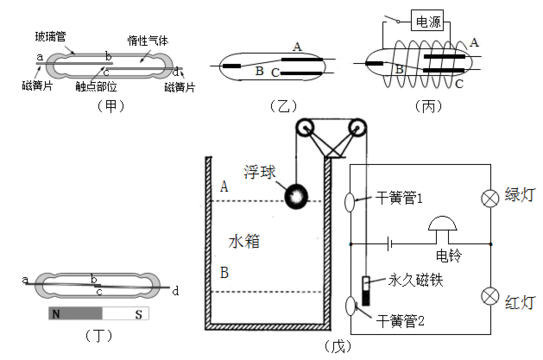

# Physics - 题目 1950

**ID**: 76f7ed2d6f274f9e8e52cdca3fa71e5e
**年级**: Grade 9
**难度**: Medium-Hard
**题型**: Comprehensive

## 题目
阅读短文，回答问题∶干簧管干簧管也叫干簧继电器，其外壳是一只密封的玻璃管，管内充有某种惰性气体。​​​​​​​‌比一般机械开关结构简单，体积小，工作寿命长，它又有抗负载冲击能力强的特点，工作可靠性很高，有单触点和双触点之分。单触点干簧管结构如图甲，其中磁簧片是一种有弹性的薄铁片，被固定于玻璃管上。双触点干簧管结构如图乙，装有A。B和C三块簧片，A的端点与C的端点是固定端点，B的端点是自由端点，正常时B的端点在自身弹力作用下与A的端点接触，当绕在干簧管上的线圈通电时，如图丙所示，B的端点与C的端点分别被磁化而相互吸引，当吸引力大于B的弹力时，B与A的端点分开，并与C的端点接触。而当B与C的吸引力减小到一定程度时，B在弹力的作用下与C的端点分开，重新恢复与A的端点接触。请回答下列问题∶（1）在图丙中，若要使螺线管的右端为N极，则电源左端是极。（2）如图丁所示，当将一个条形磁铁与干簧管平行放置时，干簧管的两磁簧片被磁化，则磁簧片ab的b端为极；磁簧片cd的c端为极。（3）干簧管在工作中所利用的电磁现象不包括

## 解答

1. (1)[1]螺线管的右端为N极，右手握住螺线管，大拇指朝右，电流从左侧流进，左侧流出，所以电源的右端是负极。
2. (2)[2][3]磁簧片ab的a端靠近条形磁铁的N极，所以a端是S极，则b端是N极；磁簧片cd的d端靠近条形磁铁的S极，所以d端是N极，则c端是S极。异名磁极相互吸引。
3. (3)[4] S闭合时，控制电路接通，线圈产生磁场，舌簧被磁化，在两舌簧端面形成异名磁极，因相互吸引而吸合，于是工作电路接通，S断开时，两舌簧退磁，在弹力作用下分开，工作电路断开。故该装置中利用了电流的磁效应、磁化及磁极间的相互作用。没有利用磁场对电流的作用。故选B。
4. (4)[5][6]当水面上升到最高水位A处时，条形磁铁位于干簧管2的右边，此时两个磁簧片被磁化后，由于是异名磁极相互吸引而相互接触，此时接通电路, 红灯发光电铃响；当水面下降到最低水位B处时，条形磁铁位于干簧管1的右边，此时两个磁簧片被磁化后，由于是异名磁极相互吸引而相互接触，此时接通电路，绿灯发光电铃响。
5. (5)[7]电池、光敏电阻与开关及干簧管继电器开关的里面两个接线构成一个回路;而另一组电池、蜂鸣器与干簧管继电器开关外面线圈的两个接线构成又一个回路。当有光照时，光敏电阻变小，使得干簧管继电器开关存在磁场，导致开关接通，最终使得蜂鸣器发声，如图所示：
6. 。

## 知识点

**中文**:
  - 安培定则及其应用
  - 电路图设计
  - 磁极间的相互作用
  - 电流的磁效应

**English**:
  - Ampere's Rule and Applications
  - Circuit Design
  - Interaction between Magnetic Poles
  - Magnetic Effect of Current

---
