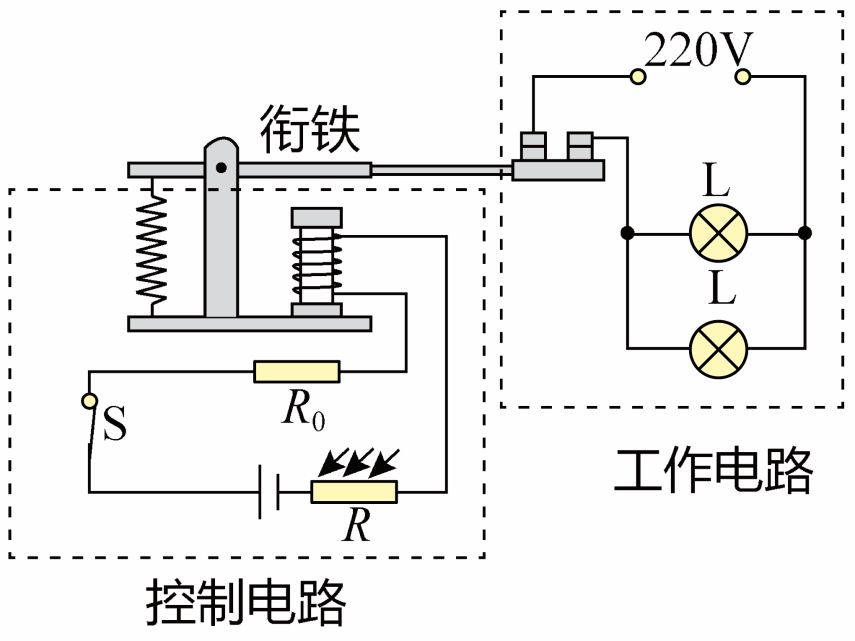

# Physics - 题目 2920

**ID**: 86606407cffe429083ffae4fdac4d11e
**年级**: Grade 9
**难度**: Medium-Hard
**题型**: Comprehensive

## 题目
小聪利用光敏电阻为社区设计了一种自动草坪灯，其工作原理如图所示。​​​​​​​‌工作电路中有两盏规格均为“220V 22W”的灯泡L，天暗时灯自动发光，天亮时灯自动熄灭。控制电路中电源电压U恒为12V，定值电阻R_{0}为200Ω。在一定范围内，光敏电阻R的阻值与光照强度E（光照强度E的单位为lx，光越强光照强度越大）之间存在一定关系，部分数据如表所示。电磁铁的线圈电阻忽略不计，当天色渐暗，通过线圈的电流为0.04A时，恰好启动工作电路的照明系统。试问：光照强度E/lx1.02.03.04.05.0光敏电阻R/Ω150755037.530（1）随着光照强度减小，光敏电阻R的阻值（选填“增大”或“减小”），电磁铁的磁性（选填“增强”或“减弱”），当光照强度减小到一定值时，衔铁会被（选填“吸下”或“释放”），照明系统启动；（2）两盏灯均正常发光时，工作电路中的总电流是多少？（3）照明系统恰好启动时，光敏电阻R的阻值为多少？此时光照强度为多少？

## 解答

1. （1）[1]由表格中数据可知，随着光照强度减小，光敏电阻R的阻值增大。
2. [2]由图中控制电路可知，光敏电阻R与定值电阻R_{0}串联，当光敏电阻R的阻值增大时，该电路的电流减小，电磁铁的磁性减弱。
3. [3]当光照强度一直减小时，光敏电阻R的阻值一直增大，该电路的电流一直减小，电磁铁的磁性一直减弱。故当光照强度减小到一定值时，衔铁会被释放，照明系统启动。
4. （2）[4]两盏灯泡的规格均为“220V 22W”，并联接在工作电流上，根据并联电路的电流特点和 $I=\frac {P}{U}$ 可知，两盏灯均正常发光时，工作电路中的总电流是
5. $I=I{{}_{1}}+I{{}_{2}}=\frac {P{{}_{1}}}{U{{}_{1}}}+\frac {P{{}_{2}}}{U{{}_{2}}}=\frac {22{\rm{W}}}{220{\rm{V}}}+\frac {22{\rm{W}}}{220{\rm{V}}}=0.2{\rm{A}}$
6. （3）[5]由题意知，通过线圈的电流为0.04A时，恰好启动工作电路的照明系统。此时控制电路的总电阻为
7. $R{{}_{总}}=\frac {U}{I{^{^{′}}}}=\frac {12{\rm{V}}}{0.04{\rm{A}}}=300{\rm{Ω}}$
8. 由串联电路的电阻特点可知，照明系统恰好启动时，光敏电阻R的阻值为
9. R=R_{总}-R_{0}=300Ω-200Ω=100Ω
10. 由表格中的数据可知，在一定范围内，光敏电阻R的阻值与光照强度E（光照强度E的单位为lx，光越强光照强度越大）之间存在一定关系，关系为
11. RE=150Ω·lx
12. 当光敏电阻R的阻值为100Ω时，此时光照强度E为
13. $E=\frac {150{\rm{Ω}}\cdot {\rm{l}}{\rm{x}}}{100{\rm{Ω}}}=1.5{\rm{l}}{\rm{x}}$

## 知识点

**中文**:
  - 电磁继电器的常见应用
  - 电磁继电器的构造及原理

**English**:
  - Common Applications of Electromagnetic Relays
  - Structure and Principle of Electromagnetic Relays

---
