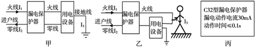

# Physics - 题目 387

**ID**: 8d9ce67d623f47719f0c5a1f4be7383d
**年级**: Grade 9
**难度**: Medium-Hard
**题型**: Comprehensive

## 题目
阅读短文，回答问题：漏电保护器根据安全用电要求，住户家里除了要安装防止电流过大的自动空气开关外，还必须安装如图所示的漏电保护器。​​​​​​​‌其示意图如图甲所示，其内部结构相当于一个自动开关，正常情况下，住户家中没有电流流向地面，即图中I_{3}为零，进户线中流入的电流I_{1}和流出的电流I_{2}相等，漏电保护器内部自动开关处于闭合状态。如果电路中某处发生漏电（漏电是指电流从墙体、人体、接地线或其他路径流向地面），即图中的I_{3}不为零，就会造成I_{1}和I_{2}不相等，当I_{1}和I_{2}的差异达到一定值，保护器内部自动开关就会立即断开。排除漏电故障后，重新合闸即可恢复供电。为确保使用安全，漏电保护器上设置了试验按钮，需要每月试按一次，如果试验按钮按下漏电保护器无动作，说明漏电保护器需要更换。(1)如果发生漏电，电流I_{1}和I_{2}大小（相等/不等）；(2)关于漏电保护器，下列说法正确的是；

## 解答

1. (1)[1]由题意可知，如果电路中某处发生漏电，电流I_{1}和I_{2}大小不相等。
2. (2)[2]A．正常情况下家庭电路中火线中的电流等于零线中的电流，A错误；
3. B．漏电保护器跳闸后按下试验按钮，保护器还是处于跳闸状态，不可恢复供电，B错误；
4. C．当电路发生短路时，没有电流从墙体、人体、接地线或其他路径流向地面，漏电保护器不会自动切断电路，C错误；
5. D．站在绝缘凳子的人单手触摸火线，没有电流从人体流向地面，因为凳子不容易导电，那么漏电保护器不会自动切断电路，D正确。
6. 故选D。
7. (3)[3]如果误将连接零线和地线的孔接反，那么左孔是地线，中间孔是零线，此时如果将洗衣机的三脚插头插入该插座，那么电流从火线孔流入，地线孔流出，有电流流向地面，漏电保护器会断开。
8. (4)[4]由题意可知，家庭电路电压是220V，人体接触火线后，该人体的电阻，人与地面、电线等的接触电阻大小是
9. $R={\rm{2}}{\rm{5}}{\rm{0}}{\rm{0}}{\rm{Ω}}+{\rm{3}}{\rm{0}}{\rm{0}}{\rm{0}}{\rm{Ω}}={\rm{5}}{\rm{5}}{\rm{0}}{\rm{0}}{\rm{Ω}}$
10. 流经人体的电流大小是
11. $I=\frac {U}{R}=\frac {{\rm{2}}{\rm{2}}{\rm{0}}{\rm{V}}}{{\rm{5}}{\rm{5}}{\rm{0}}{\rm{0}}{\rm{Ω}}}={\rm{0}}{\rm{.}}{\rm{0}}{\rm{4}}{\rm{A}}={\rm{4}}{\rm{0}}{\rm{m}}{\rm{A}}$
12. 该漏电保护器动作电流是30mA，流经人体的电流大于这个值，那么该漏电保护器能及时断开电路。
13. (5)[5]A．从图中可以看到，闭合开关时，虚线框内火线电流大小还是等于零线电流大小，所以闭合试验开关S不能模拟漏电情形，A项不合题意；
14. B．闭合开关时，通过虚线框内火线的电流小于通过该装置零线的电流，可以模拟漏电情形，选项B符合题意；
15. C．闭合开关时，虚线框内火线电流大小还是等于零线电流大小，所以闭合试验开关S不能模拟漏电情形，C项不合题意；
16. D．闭合开关时，虚线框内火线电流大小还是等于零线电流大小，所以闭合试验开关S不能模拟漏电情形，D项不合题意。
17. 故选B。

## 知识点

**中文**:
  - 家庭电路的故障分析
  - 欧姆定律的应用
  - 家庭电路的连接

**English**:
  - Fault Analysis of Household Circuits
  - Applications of Ohm's Law
  - Connection of Household Circuits

---
