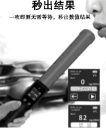
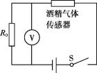
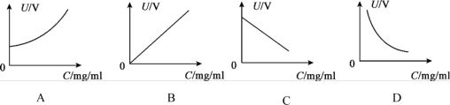

# Physics - 题目 2994

**ID**: 95f54fe296dc4862b0953e8969ab155b
**年级**: Grade 9
**难度**: Medium-Hard
**题型**: Comprehensive

## 题目
请根据材料，回答下面的问题：酒精测试仪酒精测试仪（AlcoholTester）是测试酒精含量的仪器，是交警常用的执法装备。​​​​​​​‌通常，检测驾驶员酒后驾驶的方法：一是检测血液酒精浓度；二是检测呼气酒精浓度。在违法行为处理或者公路交通例行检查中，通常是现场检测驾驶人员呼气中的酒精含量。酒精测试仪内部的核心部件是酒精气体传感器，目前普遍使用的有半导体型和燃料电池型两种。半导体型呼气酒精测试仪采用半导体型氧化锡作为传感器，它具有气敏特性，当接触的敏感气体浓度增加时，它的电阻值就降低。燃料电池型呼气酒精测试仪采用燃料电池酒精传感器，其原理是采用贵金属铂金为电极，进入燃料室的酒精经过特种催化剂催化，充分燃烧产生电压，此电压与进入燃料室内气体的酒精浓度成正比。与半导体型相比，燃料电池型呼气酒精测试仪具有稳定性好、精度高、抗干扰能力强等特点。上述两种传感器都是将酒精气体浓度的变化转换为其他量的变化，从而实现了现场快速测量。目前的测试仪采用专业喇叭形吹嘴或吹管，不需要接触吹嘴即可以进行检测，如图所示。在显示方式上，通过发光管指示灯分未饮酒区、饮酒区、酗酒区三段显示及led数码显示屏显示。一些产品还采用了震动、语音播报等功能。（1）酒精测试仪内部的核心部件是。（2）图示的是半导体型呼气酒精测试仪的简化工作电路，R_{0}为定值电阻。图中关于电压表的示数U与酒精气体浓度C之间关系的图像，正确的是。（3）酒精测试仪核心部件的工作原理利用了物理学中一种常用的方法，请举出一个采用这种方法的例子并加以解释。

## 解答

1. （1）[1]根据题意“酒精测试仪内部的核心部件是酒精气体传感器，目前普遍使用的有半导体型和燃料电池型两种”可知酒精测试仪内部的核心部件是酒精气体传感器。
2. （2）[2]图示的是半导体型呼气酒精测试仪的简化工作电路，R_{0}为定值电阻，二者串联，电压表测量定值电阻两端电压，根据串联分压，电压表的示数U与酒精气体浓度C之间关系为
3. ${\rm \frac {R{{}_{0}}}{R{{}_{0}}+R}=\frac {U}{U{{}_{0}}}}$
4. 即
5. ${\rm U=\frac {R{{}_{0}}}{R{{}_{0}}+R}U{{}_{0}}}$
6. 当接触的敏感气体浓度增加时，它的电阻值就降低，则图像A符合题意。
7. （3）[3]酒精测试仪核心部件的工作原理利用了物理学中一种常用的转换法，探究焦耳定律实验中通过液体升高的温度反映电流通过导体放出的热量；液体压强计通过液体压强计U型管两侧液面的高度差反映液体内部压强的大小都应用了此方法。

## 知识点

**中文**:
  - 半导体的特点与应用
  - 欧姆定律的应用
  - 电路的动态分析

**English**:
  - Characteristics and Applications of Semiconductors
  - Applications of Ohm's Law
  - Dynamic Circuit Analysis

---
