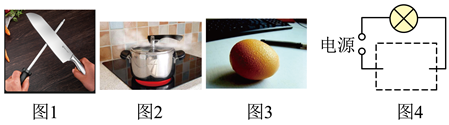

# Physics - 题目 2828

**ID**: 9794d12248714f02bda9cd5567739ced
**年级**: Grade 9
**难度**: Medium-Hard
**题型**: Comprehensive

## 题目
线上教学期间，物理老师留了一个作业：走讲厨房，发现物理。​​​​​​​‌于是小王开始细心地观察，结果发现了不少物理现象，请你帮助他运用所学的物理知识完成以下问题。（1）如图1妈妈在切肉时拿出磨刀棒将刀磨一磨，是为了增大；（2）如图2用高压锅煮肉，肉熟得快，这是因为气压高，水的沸点；（3）如图3从冰箱里拿出来的鸡蛋放在案板上一段时间，发现鸡蛋外表面有水珠，这是因为空气中的遇冷（填物态变化名称）形成的；（4）打开冰箱门时，冰箱内的灯就亮了，小王想到老师讲过，冰箱上有一个控制灯的亮灭的按钮（开关），当它被按下时（冰箱门关闭）相当于电路中开关断开，冰箱内的灯就会熄灭。于是他就开始找这个按钮，结果在冰箱的内部左右两侧各找到一个按钮，这是怎么回事儿呢？小王猜想这是因为冰箱是左右双开门的缘故，每一侧的门控制一个开关。小王研究发现用手单独按下任意一个按钮（相当于关闭一侧冰箱门）灯都亮，只有两个按钮同时按下去时灯才灭。请你根据小王的操作，在图4中将这个电路补充完整。

## 解答

1. （2）[2]水的沸点随水面上方气压的增大而升高。用高压锅煮肉，肉熟得快，是因为锅内气压高，使水的沸点升高。
2. （3）[3][4]冰箱拿出的鸡蛋放在案板上一段时间，鸡蛋外表面上出现水珠，是空气中的水蒸气遇到冷的鸡蛋外表面液化成小水珠形成的。
3. （4）[5]由题意知，同时按下两个按钮时，灯灭，所以按下按钮相当于断开开关。只断开任一开关，灯都亮，所以两个开关是并联后，再控制灯泡，作图如下：
4. 

## 知识点

**中文**:
  - 串、并联电路的设计
  - 增大及减小压强的方法与应用
  - 沸点及沸点与气压的关系
  - 液化及液化放热的特点

**English**:
  - Designing Series and Parallel Circuits
  - Methods and Applications of Increasing/Decreasing Pressure
  - Boiling Point and Air Pressure
  - Liquefaction and Heat Release

---
