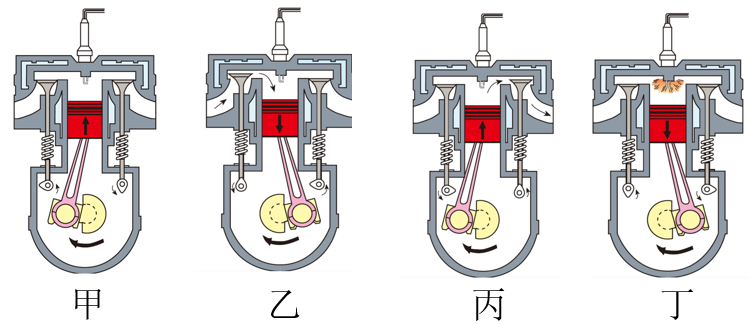

# Physics - 题目 1281

**ID**: 9fca8c00884a4712aadd269c801e22a6
**年级**: Grade 9
**难度**: Medium-Hard
**题型**: Comprehensive

## 题目
发动机是汽车的核心部件，发动机的质量决定了整车的性能和品质。​​​​​​​‌若某台以93号汽油为燃料的汽车，其发动机的相关数据如下表所示．表中空燃比指汽缸内空气和燃油的质量比。1min内完成的工作循环数2400个汽缸内汽油和空气混合气体的密度1.3kg/m^{3}汽缸的工作容积1.8L汽油的热值4.6×10^{7}J/kg发动机最大功率82.8kW空燃比12：1（1）汽车内燃机一个工作循环包括四个冲程，一个汽缸正常工作四个冲程的顺序（对甲、乙、丙、丁重新排序），其中内能转化为机械能的冲程是图。（2）汽车以120km/h的速度匀速运动时发动机的输出功率最大，此时汽车1min内做的有用功是多少？（）（3）汽车完成一个工作循环时，气缸内汽油和空气混合气体的质量是kg，气缸内汽油的质量是kg，燃料完全燃烧放出的热量是多少？（）（4）当汽车以120km/h的速度匀速行驶时，发动机的效率是多大？（）

## 解答

1. (1)[1][2]甲中的两个气阀都关闭，活塞向上运动，所以为压缩冲程，是第二冲程。
2. 乙中的一个气阀打开，活塞向下运动，所以为吸气冲程，是第一冲程。
3. 丙中的一个气阀打开，活塞向上运动，所以为排气冲程，是第四冲程。
4. 丁中的两个气阀都关闭，活塞下运动，所以为做功冲程，是第三冲程。
5. 故一个汽缸正常工作四个冲程的顺序是：乙甲丁丙。
6. 其中做功冲程（即图丁）内燃机给汽车提供动力，此冲程中能量的转化是内能转化为机械能。
7. (2)[3]发动机的最大功率
8. P=82.8kW=8.28×10^{4}W
9. 时间
10. t=1min=60s
11. 汽车1min内做的有用功
12. W_{有}=Pt=8.28×10^{4}W×60s=4.968×10^{6}J
13. (3)[4][5]汽缸内汽油和空气混合气体的体积等于汽缸的工作容积，即
14. V=V_{容}=1.8L=1.8×10^{-3}m
15. 汽油和空气混合气体的质量
16. m=ρV=1.3kg/m^{3}×1.8×10^{﹣}^{3}m^{3}=2.34×10^{-3}kg
17. 因为空燃比是13∶1，所以汽油的质量
18. m_{汽油}= $\frac {1}{13}$m= $\frac {1}{13}$ ×2.34×10^{﹣}^{3}kg=1.8×10^{-4}kg
19. 完成一个工作循环时，汽油燃烧释放的热量
20. Q_{放}=m_{汽油}q=1.8×10^{-4}kg×4.6×10^{7}J/kg=8.28×10^{3}J
21. (4)[6]1min内完成的工作循环数是2400个，则1min内汽油燃烧释放的热量
22. Q_{放}′=2400Q_{放}=2400×8.28×10^{3}J=1.9872×10^{7}J
23. 发动机的效率
24. η$\frac {W{{}_{有}}}{Q{{}_{放}}{^{\prime }}}{\rm{=}}\frac {4.968\times 10{^{6}}{\rm{J}}}{1.9872\times 10{^{7}}{\rm{J}}}$ ×100%=25%

## 知识点

**中文**:
  - 内燃机的四个冲程
  - 密度公式的应用
  - 功的计算和估算
  - 热值及相关计算
  - 有关热机效率的计算

**English**:
  - Four Strokes of Internal Combustion Engines
  - Application of Density Formula
  - Calculation and Estimation of Work
  - Calorific Value and Calculations
  - Calculations of Heat Engine Efficiency

---
