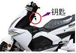
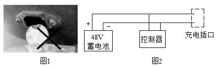
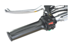

# Physics - 题目 694

**ID**: a6bf96dfff9145e59369167816c21e37
**年级**: Grade 9
**难度**: Medium-Hard
**题型**: Comprehensive

## 题目
如图所示为人们所喜爱的电动自行车，它轻便、节能、环保。​​​​​​​‌只要将图甲中车钥匙插入锁孔并顺时针旋转一下，车子就通电了，但不会行驶。（1）这车钥匙实质相当于一个，跨上自行车将右手把向后旋转，车子就能前进，并且向后旋转的角度越大，车速就越快，右手把实质相当于一个。（2）给电动车充电时，电瓶相当于（电源/用电器），将能转化为能。（3）图1是电动车的充电插口，内有金属插脚，在使用过程中绝不能拿硬币、手等去触碰；图2是电动车的局部电路图，其中控制器是指电动车利用蓄电池工作的所有用电器。如果硬币碰到充电插口的两个金属插脚，可能会造成（蓄电池/控制器/充电插口）损坏；如果人体触碰蓄电池两极，人（有/无）危险。（4）电动自行车两刹车手柄（如图）中各有一只开关S_{1}和S_{2}。在行驶中用任一只手柄刹车时，该手柄上的开关立即断开，电动机停止工作，以下电路符合要求的是（）

## 解答

1. (1)[1]车钥匙插入锁孔并顺时针旋转一下，车子就通电了，说明车钥匙相当于一个开关；
2. [2]右手把向后旋转，车子就能前进，并且向后旋转的角度越大，车速就越快，说明通过旋转把手使接入阻值发生变化，从而电流发生变化改变车速，故右手把实质相当于一个滑动变阻器；
3. (2)[3][4][5]为电瓶充电时，电瓶相当于用电器，将电能转化为化学能储存在电瓶中；
4. (3)[6]如果硬币碰到充电插口的两个金属插脚，会造成电源短路，造成蓄电池损坏；
5. [7]对于人体而言，安全的电压应是不高于36V，蓄电池的电压为48V，则如果人体触碰蓄电池两极，有触电的危险；
6. (4)[8]由题意可知，左右开关任意一个开关断开，电动机均会停止工作，故两开关应串联，故选D。

## 知识点

**中文**:
  - 串、并联电路的设计
  - 能量的转化
  - 电路的组成与连接
  - 滑动变阻器的使用

**English**:
  - Designing Series and Parallel Circuits
  - Transformation of Energy
  - Components and Connection of Circuits
  - Using a Sliding Rheostat

---
