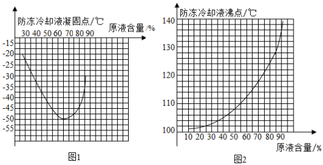

# Physics - 题目 1441

**ID**: a7aa01a0cf864e0bb15810973e6c29ce
**年级**: Grade 9
**难度**: Medium-Hard
**题型**: Comprehensive

## 题目
汽车发动机防冻液主要由水和某种防冻剂《简称原液》混合而成，原液含量（防冻剂占防冻液体积的比例）变化，防冻冷却液的凝固点和沸点与原液含量的关系图像见图1和图2所示。​​​​​​​‌选用时，防冻冷却液的凝固点应低于环境最低温度 $10℃$ 以下，而沸点一般要高于发动机最高工作温度 $5℃$ 以上。（1）在北方寒冷的冬天，停车时间比较长，会因水结冰容易导致散热器管道胀裂，因为当水结冰时，体积（选填“变小”、“不变”或“变大”），依据是。（2）分析图像，下列说法正确的一项是（填下列选项）

## 解答

1. （1）[1][2]由于冰的密度比水小，质量一定的水结冰时，由 $ρ=\frac {m}{V}$ 知道，体积增大。所以，当水结冰时易导致散热器管道胀裂。
2. （2）[3]由图1图2知道，防冻冷却液的凝固点先随原液含量的增加而降低，当原液含量超过 $65\%$ 后，防冻冷却液的凝固点随原液含量的增加而升高；防冻冷却液的沸点随原液含量的增加而升高。
3. 故选A。
4. （3）[4]由图1、图2知道，原液含量 $35\%$ 、 $45\%$ 都不符合防冻冷却液的凝固点应低于环境最低温度 $10℃$ 以下，而沸点一般要高于发动机最高工作温度 $5℃$ 以上的标准。

## 知识点

**中文**:
  - 与密度有关的物理现象
  - 熔点和凝固点
  - 沸点及沸点与气压的关系

**English**:
  - Physical Phenomena Related to Density
  - Melting Point and Freezing Point
  - Boiling Point and Air Pressure

---
