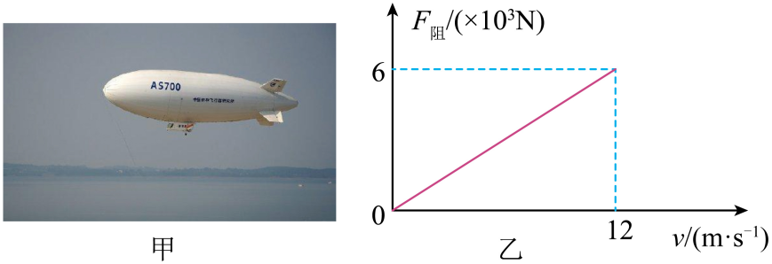

# Physics - 题目 133

**ID**: a949fcfaf13949fc87771a36d68bfe02
**年级**: Grade 9
**难度**: Medium-Hard
**题型**: Comprehensive

## 题目
阅读短文，回答问题。​​​​​​​‌载人飞艇2024年3月30日，我国自主研制的“祥云”AS700载人飞艇成功完成首飞。某飞艇如图甲所示，其气囊体积巨大，采用轻质材料制作。飞艇升空靠浮力来实现，水平飞行靠发动机提供动力。发动机输出的能量用于做推动功和辅助功：推动功指克服空气阻力推动飞艇水平飞行做的功；辅助功指发动机驱动飞艇上发电机工作所做的功，辅助功的功率恒定。当飞艇低速 $\left ({v⩽12{\rm{m}}{\rm{/}}{\rm{s}}}\right )$ 水平直线飞行时，其受到的空气阻力 $F{{}_{阻}}$ 与速度v的关系如图乙所示。飞艇部分参数见表。忽略气囊厚度及气囊外其他部分受到的浮力。空载质量（不含氦气）3750kg气囊总容积${{4}}{{2}}{{0}}{{0}}{\rm{m}}{^{{{3}}}}$发动机额定输出功率$3\times 10{^{5}}{\rm{W}}$辅助功的功率$5\times 10{^{4}}{\rm{W}}$发动机效率36%最大速度70km/h（1）气囊采用轻质材料制作是为了减小；（2）飞艇的发电机利用的原理发电；（3）将气囊充满氦气，此时飞艇受到的浮力为N，飞艇最多可载位乘客升空；（每位乘客质量 $m=60{\rm{k}}{\rm{g}}$ ， $ρ{{}_{空气}}=1.2{\rm{k}}{\rm{g}}{\rm{/}}{\rm{m}}{^{{{3}}}}$ ， $ρ{{}_{氦气}}=0.2{\rm{k}}{\rm{g}}{\rm{/}}{\rm{m}}{^{{{3}}}}$ ， $g={{1}}{{0}}{\rm{N}}{\rm{/}}{\rm{k}}{\rm{g}}$ ）（4）飞艇先后以3m/s和6m/s的速度水平匀速直线飞行相同的时间，推动功分别为 $W{{}_{1}}$ 和 $W{{}_{2}}$ ，则 $W{{}_{1}}:W{{}_{2}}=$；（5）飞艇低速水平匀速直线飞行时，若消耗10kg燃油，可飞行的最大距离为km。（燃油热值 $q{{}_{油}}=4.5\times 10{^{7}}{\rm{J}}{\rm{/}}{\rm{k}}{\rm{g}}$ ）

## 解答

1. （1）气囊采用轻质材料制作，因为轻质材料密度小，根据 $m=ρV$ 可知，体积一定时是为了减小飞艇的质量，从而减小重力。
2. （2）飞艇的发电机利用电磁感应现象的原理发电，将机械能转化为电能。
3. （3）飞艇受到的浮力 $F{{}_{浮}}=ρ{{}_{空气}}gV{{}_{排}}=1.2{\rm{k}}{\rm{g}}/{\rm{m}}{^{3}}\times 10{\rm{N}}/{\rm{k}}{\rm{g}}\times 4200{\rm{m}}{^{3}}=5.04\times 10{^{4}}{\rm{N}}$ ， 飞艇载最多乘客升空时，飞艇的重力等于受到的浮力，即 $G=F{{}_{浮}}=5.04\times 10{^{4}}{\rm{N}}$ ，则飞艇的总质量 $m{{}_{总}}=\frac {G}{g}=\frac {5.04\times 10{^{4}}{\rm{N}}}{10{\rm{N}}/{\rm{k}}{\rm{g}}}=5.04\times 10{^{3}}{\rm{k}}{\rm{g}}$ ，气囊总容积4200m^{3}，氦气的质量 $m{{}_{氦气}}=ρ{{}_{{{}_{氦气}}}}V{{}_{{{}_{氦气}}}}=0.2{\rm{k}}{\rm{g}}/{\rm{m}}{^{3}}\times 4200{\rm{m}}{^{3}}=840{\rm{k}}{\rm{g}}$ ，飞艇最多可载乘客的质量 $m{{}_{人}}=m{{}_{总}}-m{{}_{飞艇}}-m{{}_{氦气}}=5.04\times 10{^{3}}{\rm{k}}{\rm{g}}-3750{\rm{k}}{\rm{g}}-840{\rm{k}}{\rm{g}}=450{\rm{k}}{\rm{g}}$ ，飞艇最多可载乘客的位数 $n=\frac {m{{}_{总}}}{m}=\frac {450{\rm{k}}{\rm{g}}}{60{\rm{k}}{\rm{g}}}=7.5$ （位），取整数，即飞艇最多可载7位乘客升空。
4. （4）由图乙可知，飞艇先后以3m/s和6m/s的速度水平匀速直线飞行时受到的阻力分别为1.5×10^{3}N、3×10^{3}N，因 $W=Fs=fvt$ ，所以推动功之比 $\frac {W{{}_{1}}}{W{{}_{2}}}=\frac {f{{}_{1}}v{{}_{1}}t}{f{{}_{2}}v{{}_{2}}t}=\frac {f{{}_{1}}}{f{{}_{2}}}\times \frac {v{{}_{1}}}{v{{}_{2}}}=\frac {1.5\times 10{^{3}}{\rm{N}}}{3\times 10{^{3}}{\rm{N}}}\times \frac {3{\rm{m}}/{\rm{s}}}{6{\rm{m}}/{\rm{s}}}=\frac {1}{4}$ ，故 $W{{}_{1}}:W{{}_{2}}=1:4$ 。
5. （5）燃油完全燃烧释放的热量 $Q{{}_{放}}=m{{}_{油}}q{{}_{油}}=10{\rm{k}}{\rm{g}}\times 4.5\times 10{^{7}}{\rm{J}}/{\rm{k}}{\rm{g}}=4.5\times 10{^{8}}{\rm{J}}$ ，由 $η=\frac {W}{Q{{}_{放}}}$ ​可得，发动机做的功 $W=ηQ{{}_{放}}=36\%\times 4.5\times 10{^{8}}{\rm{J}}=1.62\times 10{^{8}}{\rm{J}}$ ，由图乙可知， $f=500v$ 。由 $W=W{{}_{推}}+W{{}_{辅}}$ 可得 $1.62\times 10{^{8}}{\rm{J}}=500vs+5\times 10{^{4}}{\rm{W}}\times t$ ，由 $t=\frac {s}{v}$ 可得 $s=\frac {1.62\times 10{^{8}}{\rm{J}}}{500v+5\times 10{^{4}}{\rm{W}}\times \frac {1}{v}}$ ①，当 $500v=5\times 10{^{4}}{\rm{W}}\times \frac {1}{v}$ 时， $v=10{\rm{m}}{\rm{/}}{\rm{s}}$ 。此时①式中的分母有最小值，s有最大值，此时 $s=\frac {1.62\times 10{^{8}}}{500\times 10+5\times 10{^{4}}\times \frac {1}{10}}{\rm{m}}=1.62\times 10{^{4}}{\rm{m}}=16.2{\rm{k}}{\rm{m}}$ 。

## 知识点

**中文**:
  - 与密度有关的物理现象
  - 阿基米德原理的应用
  - 物体的浮沉条件及其应用
  - 功的计算和估算
  - 热值及相关计算
  - 有关热机效率的计算
  - 电磁感应现象

**English**:
  - Physical Phenomena Related to Density
  - Applications of Archimedes' Principle
  - Floating/Sinking Conditions and Applications
  - Calculation and Estimation of Work
  - Calorific Value and Calculations
  - Calculations of Heat Engine Efficiency
  - Electromagnetic Induction

---
