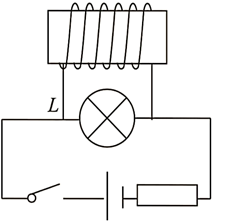
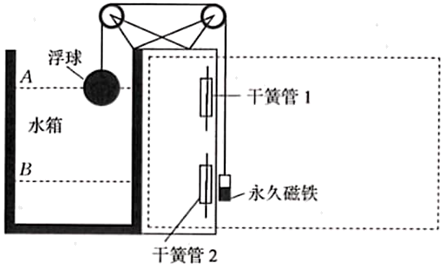
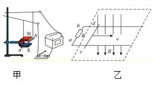

# Physics - 题目 7

**ID**: b7e5939f975744e2a83899c0c1b32944
**年级**: Grade 9
**难度**: Medium-Hard
**题型**: Comprehensive

## 题目
在我们的日常生活、工业生产和高科技领域里，磁被广泛运用。​​​​​​​‌请回答下列一组与磁有关的问题。（1）将一个电磁铁和白炽灯并联后接入电路，如图所示，当闭合电键时，灯L即刻点亮，随后熄灭；当断开电键时，灯会闪亮后熄灭。此现象说明当闭合电键时，流过电磁铁的电流变化是；当断开电键时，流过电磁铁的电流变化是。（2）干簧管也叫干簧继电器，当将一个条形磁铁与干簧管平行放置时，干簧管的磁簧片就会被磁化，且靠近的那两个端点会被磁化成异名磁极，触点就会闭合，将电路接通；当条形磁铁远离干簧管时，磁簧片的磁性消失，触点就会断开。华华同学设想用干簧管制作水位自动报警器，下图是他设计的一部分情况，请帮助他完成其余部分的设计：①设永久磁铁所受的重力为3N，浮球的体积为200cm^{3}，不计滑轮处的摩擦。则要想让此装置能正常工作，浮球的质量应满足的条件是。②他手边还有开关、红灯、绿灯和电铃各一个，导线若干，请在图中的虚线方框内画出报警电路， 要求：水位到达A处时，红灯亮，电铃报警；水位到达B处时，绿灯亮，电铃报警。（3）我们已经知道通电导线在磁场中会受到的力的作用，这是法国物理学家安培首先通过实验确定的，因此该力被称为安培力。如图甲，一段长度为L的直导线ab，通过的电流强度为I，垂直于磁场方向放置在磁感应强度为B的均匀磁场中，则这段通电导线受到的安培力的大小F与电流强度I、长度L，磁感应强度B的关系为F＝kBIL，其中k=1N/(T·A·m)。若将图甲中的电源换为发电机，发电机结构如图乙虚线内所示，我们加道，要使闭合电路中有电流，这个电路中必须有电源，在电磁感应现象里，既然闭合电路里有感应电流，那么这个电路中也必定有电压，在电磁感应现象中产生的电压也叫感应电动势，用E表示，在磁场中做切割磁感线运动的导体cd相当于电源。长度为L的导体cd以速度ν在磁感应强度为B的匀强磁场中做切割磁感应线运动时，在B、L、ν的方向互相垂直的情况下，导体cd中产生的感应电动势的大小为：E＝BLν，那么图乙中，求：导体ab受到的安培力F与导体ab的电阻R、长度L、磁感应强度B运动速度v之间的关系。

## 解答

1. （1）[1][2]因为电磁铁的线圈是一个储能元件，当闭合开关时，灯L_{1}即刻点亮，随后熄灭，说明在总电流不变的情况下，电磁铁中的电流逐渐增大，从而使流经灯泡的电流减小而熄灭；当断开开关时，灯会闪亮后熄灭，说明电磁铁在断电后释放了其储存的电能，使灯闪亮，流过电磁铁的电流是逐渐减小的。
2. （2）[3]浮球浸没水中受到的浮力
3. F浮=ρ_{水}gV_{排}=1×10^{3}kg/m^{3}×10N/kg×200×10^{-6}m^{3}=2N
4. 设浮球刚好浸没水中，浮球必须上浮，则必须满足
5. G_{浮球}＜F_{浮}+G_{磁}_{铁}=2N+3N=5N
6. 设浮球刚好离开水面，浮球必须下降，则必须满足
7. G_{浮球}＞G_{磁}_{铁}=3N
8. 因此要想让此装置能正常工作，此浮球所受的重力应满足
9. 5N＞G_{浮球}＞3N
10. 根据G=mg可知浮球的质量应满足
11. 0.5kg＞m_{浮球}＞0.3kg
12. [4]设计报警电路如下：
13. （3）[5]由题知，导体cd中产生的感应电动势的大小为：E＝BLν，则电路中的电流
14. $I=\frac {E}{R}=\frac {BLv}{R}$
15. 导体ab受到的安培力
16. $F=BIL=B\times \frac {BLv}{R}\times L=\frac {B{^{2}}L{^{2}}v}{R}$

## 知识点

**中文**:
  - 串、并联电路的设计
  - 物体的浮沉条件及其应用
  - 电磁铁在实际生活中的应用
  - 电磁继电器的常见应用
  - 电磁感应现象

**English**:
  - Designing Series and Parallel Circuits
  - Floating/Sinking Conditions and Applications
  - Real-life Applications of Electromagnets
  - Common Applications of Electromagnetic Relays
  - Electromagnetic Induction

---
