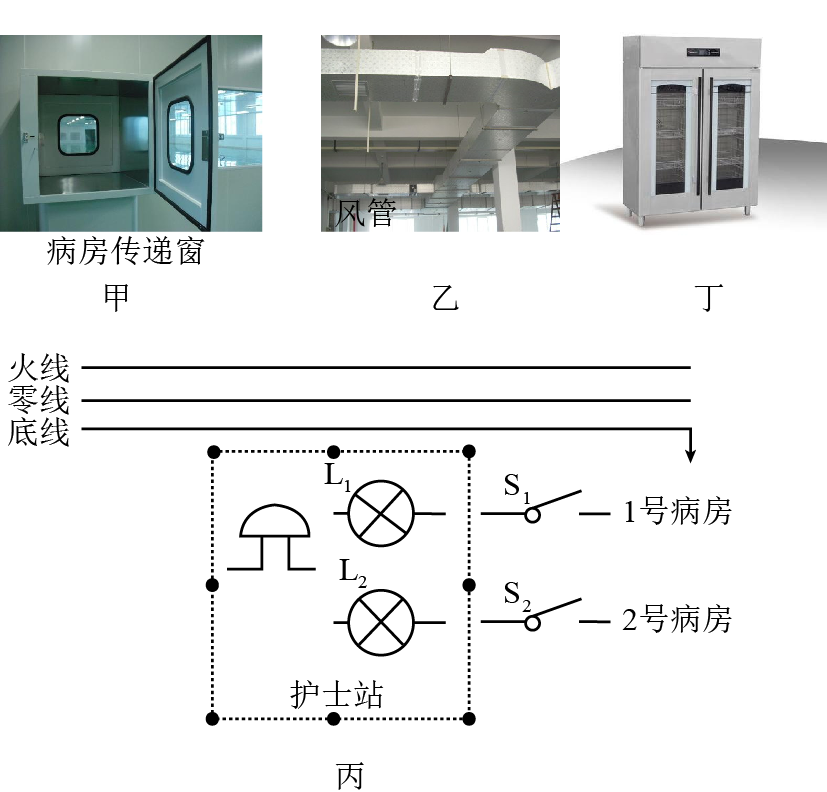

# Physics - 题目 949

**ID**: bb84e0470748414e944018b366ebde0c
**年级**: Grade 9
**难度**: Medium-Hard
**题型**: Comprehensive

## 题目
2020年的春节是防控新型冠状病毒感染的肺炎疫情的关键时刻，武汉火神山医院构筑起疫情防控前线的坚强堡垒，能够让更多患者得到及时有效的救治，成为武汉战“疫”的坚强支点。​​​​​​​‌记者探访武汉火神山医院发现，病房内拥有空调、电视等设备，房间还有WiFi、智能报警、医护对讲等多种功能。(1)如图甲所示，为避免感染，医院的每间病房设置一个传递窗，传递窗由两层玻璃和电磁波消毒系统构成，医护人员打开外面一层玻璃窗将药品和食品放入传递舱内，经电磁波消毒后房间内的人才能打开里面一层玻璃窗取用物品，下面常用于医疗消毒的是。

## 解答

1. (1)[1]A．微波是波长很短的电磁波，食物的分子在微波的作用下剧烈振动，使得内能增加，温度升高，达到成熟状态，但不用于消毒杀菌，故A不符合题意；
2. B．红外线波长较长，容易穿过云雾烟尘，不用于杀菌消毒，故B不符合题意；
3. C．红色可见光即我们见到红光，没有杀菌消毒的作用，故C不符合题意；
4. D．紫外线，有杀菌消毒的特性，故D符合题意。
5. 故选D。
6. (2)[2]拼缝处打胶能将多段风管牢固连接，是利用了分子之间存在引力的物理道理。
7. (3)[3]A．两船并排快速前行，可导致中间水流速变大，压强变小，水对船的压强差压着船向中间靠近，造成事故。故A符合题意；
8. B．雨雪天气，道路湿滑，汽车与地面之间的摩擦力减小，不利于汽车的刹车、转向等，所以要减速慢行，故B不符合题意；
9. C．飞机机翼和鸟的翅膀上部凸起，在机翼或翅膀上方的空气流速快压强小，在机翼或翅膀下方的空气流速慢压强大，压力差形成向上的升力，故C符合题意；
10. D．人离列车太近时，高速列车行驶过程中，使人和列车之间的空气流动速度很大，压强很小，人外侧的压强不变，人在内外压强差的作用下，被压向列车出现事故，故D符合题意。
11. 故选ACD。
12. (4)[4]L_{1}灯亮，说明1号病房需要帮助；L_{2}灯亮，说明2号病房需要帮助，两灯互不影响，故两灯并联；S_{1}只控制L_{1}，S_{2}只控制L_{2}，根据安全用电的原则，开关要控制火线；无论哪间病房需要帮助，电铃都会响起示警，则电铃接在干路上，如下所示：
13. 
14. (5)[5]消毒一次，消耗水的体积为
15. $V{\rm{=}}{\rm{8}}{\rm{0}}{\rm{L}}{\rm{=}}{\rm{8}}{\rm{0}}{\rm{×}}{\rm{1}}{\rm{0}}{^{﹣{\rm{3}}}}{\rm{m}}{^{{\rm{3}}}}{\rm{=}}{\rm{8}}{\rm{×}}{\rm{1}}{\rm{0}}{^{﹣{\rm{2}}}}{\rm{m}}{^{{\rm{3}}}}$
16. 消毒一次消耗水的质量为
17. $m{\rm{=}}ρV{\rm{=}}{\rm{1}}{\rm{.}}{\rm{0}}{\rm{×}}{\rm{1}}{\rm{0}}{^{{\rm{3}}}}{\rm{k}}{\rm{g}}{\rm{/}}{\rm{m}}{^{{\rm{3}}}}{\rm{×}}{\rm{8}}{\rm{0}}{\rm{×}}{\rm{1}}{\rm{0}}{^{﹣}}{^{{\rm{3}}}}{\rm{m}}{^{{\rm{3}}}}{\rm{=}}{\rm{8}}{\rm{0}}{\rm{k}}{\rm{g}}$
18. 由题意可知，把水从20℃加热到120℃，则水箱中水吸收的热量为
19. $Q{{}_{吸}}{\rm{=}}cmΔt{\rm{=}}{\rm{4}}{\rm{.}}{\rm{2}}{\rm{×}}{\rm{1}}{\rm{0}}{^{{\rm{3}}}}{\rm{J}}{\rm{/}}{\rm{(}}{\rm{k}}{\rm{g}}{\rm{·}}℃{\rm{)}}{\rm{×}}{\rm{8}}{\rm{0}}{\rm{k}}{\rm{g}}{\rm{×}}{\rm{(}}{\rm{1}}{\rm{2}}{\rm{0}}℃-{\rm{2}}{\rm{0}}℃{\rm{)}}{\rm{=}}{\rm{3}}{\rm{.}}{\rm{3}}{\rm{6}}{\rm{×}}{\rm{1}}{\rm{0}}{^{{\rm{7}}}}{\rm{J}}$
20. [6]消毒柜的额定功率为16.0kW，消毒一次（正常工作40min），消毒柜消耗的电能为
21. $W{\rm{=}}Pt{\rm{=}}{\rm{1}}{\rm{.}}{\rm{6}}{\rm{×}}{\rm{1}}{\rm{0}}{^{{\rm{4}}}}{\rm{W}}{\rm{×}}{\rm{4}}{\rm{0}}{\rm{×}}{\rm{6}}{\rm{0}}{\rm{s}}{\rm{=}}{\rm{3}}{\rm{.}}{\rm{8}}{\rm{4}}{\rm{×}}{\rm{1}}{\rm{0}}{^{{\rm{7}}}}{\rm{J}}$

## 知识点

**中文**:
  - 分子间的作用力
  - 红外线的特点及应用
  - 紫外线的特点及应用
  - 流体压强与流速的关系
  - 家庭电路的连接
  - 电与热综合计算

**English**:
  - Intermolecular Forces
  - Characteristics and Applications of Infrared
  - Characteristics and Applications of Ultraviolet
  - Relationship between Fluid Pressure and Flow Speed
  - Connection of Household Circuits
  - Comprehensive Calculation of Electricity and Heat

---
