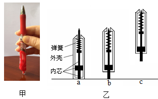

# Physics - 题目 1634

**ID**: be8e4577134a42a09fc3881b6ccb5688
**年级**: Grade 9
**难度**: Medium-Hard
**题型**: Comprehensive

## 题目
小红发现日常学习和生活中的一些用具的使用方法是“按压式的”。​​​​​​​‌（1）如图甲所示，小红将一支内有弹簧的圆珠笔向下按压，放手后笔会向上弹起一定高度。为了研究方便，把笔筒化为外壳、内芯和轻质弹簧三部分。弹跳过程出可以分为三个阶段，如图乙所示：①把笔竖直倒立于水平硬桌面，下压外壳使其下端接触桌面（见位置a）；②由静止释放，外壳竖直上升与静止的内芯碰撞（见位置b）；③碰撞后内芯与外壳以共同的速度一起上升到最大高度处（见位置c）。下列关于该过程中能量变化的说法正确的是

## 解答

1. (1)[1]A．向下按笔的过程中，弹簧的弹性形变程度变大，所以弹簧的弹性势能变大，故A错误；
2. B．向下按笔的过程中，笔的高度减小，所以其重力势能减小，故B错误；
3. C．笔向上弹起的过程中，笔的质量不变，高度增加，所以笔的重力势能增大，故C正确；
4. D．笔向上弹起的过程中，弹簧的形变程度变小，所以其弹性势能变小，故D错误。
5. 故选C。
6. (2)①[2]按压瓶盖，瓶内气体被压缩，压强变大，大于外界大气压，洗手液在内外气压差的作用下被“吸”上来，利用的是大气压。
7. A．船闸的基本原理是连通器，与大气压无关，不合题意；
8. B．抽水机抽水，通过活塞上移或叶轮转动使抽水机内水面上方的气压减小，水在外界大气压的作用下，被压上来，利用了大气压，符合题意；
9. C．微小压强计是用来测量液体压强的，U形管两侧液面出现高度差越大，液体压强越大，与大气压无关，不合题意；
10. D．汽油机是将空气与汽油以一定的比例混合成良好的混合气，在吸气冲程中被吸入汽缸，混合气经压缩点火燃烧而产生内能，高温高压的气体作用于活塞顶部，推动活塞作往复运动，通过连杆、曲轴飞轮机构对外输出机械能，与大气压无关，不合题意。
11. 故选B。
12. ②[3]由①可知，洗手液能被“吸”上来是利用了大气压。
13. ③[4]向下按压后松手时，液体从导液管通过进液阀门进入到储液筒，说明瓶中气压大于储液筒中气压。

## 知识点

**中文**:
  - 大气压的应用
  - 连通器原理
  - 重力势能的变化问题
  - 弹性势能的变化问题
  - 汽油机的构造与工作过程

**English**:
  - Applications of Atmospheric Pressure
  - Principle of Communicating Vessels
  - Changes in Gravitational Potential Energy
  - Changes in Elastic Potential Energy
  - Structure and Operation of Gasoline Engines

---
