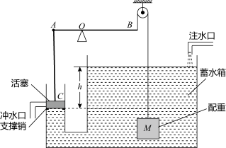

# Physics - 题目 1571

**ID**: c50408cd037549caa2b0e67c69622847
**年级**: Grade 9
**难度**: Medium-Hard
**题型**: Comprehensive

## 题目
如图所示为某学校厕所内自动冲水装置简化的原理图，这种装置能定时为便池冲水。​​​​​​​‌注水口通过阀门控制可保持细小水流不停地向水箱内注水。活塞下方有支撑销（体积不计）支撑，随着水位的升高，当活塞被顶起时水由冲水口快速流出，当两侧液面相平时，活塞落下，冲水结束；杠杆AB处在水平位置，O为支点，OA：OB=1：2，A端通过竖直顶杆AC与活塞相连，连接配重M的细绳通过定滑轮竖直作用在B端。已知活塞的横截面积S_{1}=10cm^{2}，右侧蓄水箱的横截面积为S_{2}=0.12m^{2}，注水速度为20cm^{3}/s，配重M的质量m=0.5kg，密度 $ρ$_{物}=2.0×10^{3}kg/m^{3}，不计杆AB、顶杆AC、绳及活塞的重力，不计摩擦，不考虑冲水所用的时间， $ρ$_{水}=1.0×10^{3}kg/m^{3}，g=10N/kg，设活塞刚被顶起时，杠杆水平，两侧水面高度差为h，求：（1）配重M所受浮力F_{浮}；（2）两侧水面高度差h；（3）前后两次冲水的时间间隔；（4）若将配重M更换成相同材料体积较小的物体，装置的其它部分不变，则前后两次冲水的时间间隔怎样变化?此方法能否起到节水的作用?

## 解答

1. 解：（1）配重M所受浮力F_{浮}
2. $F{{}_{浮}}=ρ{{}_{水}}gV{{}_{排}}=1.0\times 10{^{3}}{\rm kg}/{\rm m}{^{3}}\times 10{\rm N}/{\rm kg}\times \frac {0.5{\rm kg}}{2.0\times 10{^{3}}{\rm kg}/{\rm m}{^{3}}}=2.5{\rm N}$
3. （2）细绳通过定滑轮竖直作用在B端的拉力
4. $F{{}_{{\rm B}}}=G{{}_{{\rm M}}}-F{{}_{浮}}{\rm{=}}0.5{\rm{k}}{\rm{g}}\times 10{\rm N}/{\rm kg}-2.5{\rm N}=2.5{\rm N}$
5. 根据杠杆的平衡条件，杠杆A端的作用力为
6. $F{{}_{{\rm A}}}=\frac {F{{}_{{\rm B}}}\times OB}{OA}=2.5{\rm N}\times \frac {2}{1}=5{\rm N}$
7. 即作用在活塞上的力为5N，则有
8. $P=ρ{{}_{水}}gh=1.0\times 10{^{3}}{\rm kg}/{\rm m}{^{3}}\times 10{\rm N}/{\rm kg}\times h=\frac {F{{}_{{\rm A}}}}{S{{}_{1}}}=\frac {5{\rm N}}{10\times 10{^{-4}}{\rm m}{^{2}}}$
9. 解得两侧水面高度差h
10. $h=0.5{\rm m}$
11. （3）前后两次冲水的时间间隔
12. $t=\frac {V}{v}=\frac {S{{}_{2}}h}{v}=\frac {0.12{\rm m}{^{2}}\times 0.5{\rm m}}{20\times 10{^{-6}}{\rm m}{^{3}}/{\rm s}}=3000{\rm s}$
13. （4）若将配重M更换成相同材料体积较小的物体，装置的其它部分不变，
14. $F^{′}{{{}_{{\rm B}}}}=(ρ{{}_{物}}-ρ{{}_{水}})gV^{′}{{{}_{排}}}$
15. $F^{′}{{{}_{{\rm B}}}}$ 减小，使 $F^{′}A$  减小，h减小，则前后两次冲水的时间间隔减小，此方法不能起到节水的作用，要想节水，需减小注水速度。
16. 答：（1）配重M所受浮力F_{浮}=2.5N；
17. （2）两侧水面高度差h=0.5m；
18. （3）前后两次冲水的时间间隔为3000s。

## 知识点

**中文**:
  - 定滑轮及其工作特点
  - 液体压强计算公式的应用
  - 阿基米德原理的应用
  - 杠杆平衡条件的应用

**English**:
  - Fixed Pulleys and Operating Characteristics
  - Application of Liquid Pressure Formula
  - Applications of Archimedes' Principle
  - Application of Lever Equilibrium Conditions

---
