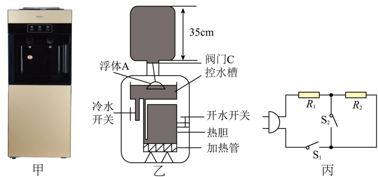

# Physics - 题目 1507

**ID**: c7ca172e3d5e44a0882aee6010b0caa1
**年级**: Grade 9
**难度**: Medium-Hard
**题型**: Comprehensive

## 题目
如图甲所示小明家里新买了一台饮水机，它的结构示意图如图乙，简化电路图如图丙，绿灯亮时为保温状态，红灯亮时为加热状态，加热电功率为800W。​​​​​​​‌在图乙中，控水槽内浮体A与阀门C固定相连，当A恰好浸没时阀门C关闭，A未浸没时C略有下降，桶内水流入控水槽中。桶内水位高35cm，阀门C横截面积1cm2，[不计A、C本身重力、大气压，g取10N/kg， $c{{}_{水}}={\rm{4}}{\rm{.}}{\rm{2}}\times {\rm{1}}{\rm{0}}{^{{\rm{3}}}}{\rm{J}}{\rm{/}}\left ({{\rm{k}}{\rm{g}}\cdot ℃}\right )$ ]问：（1）饮水机处于加热状态时，开关S1，开关S2（选填“闭合”或“断开”）；（2）当桶内水位高35cm时，阀门C受到的压强为Pa，控水槽内保持一定水位，浮体排开水的最小体积应为m3；（3）饮水机热胆中有1L初温为20℃的水，正常加热10min，恰好使水的温度升高到100℃，则水吸收的热量是J，饮水机正常加热的效率是。

## 解答

1. （1）[1][2]由图丙知，S1闭合，S2断开时，R1与R2串联，电路总电阻最大，两开关都闭合时，只有R1连入电路，电路总电阻最小，在电压一定时，由 $P=\frac {U{^{2}}}{R}$ 可知，两开关都闭合时电路消耗功率较大，饮水机处于加热状态。
2. （2）[3]当桶内水位高35cm时，阀门C受到的压强为
3. $p=ρ{{}_{水}}gh＝{\rm{1}}\times {\rm{1}}{\rm{0}}{^{{\rm{3}}}}{\rm{k}}{\rm{g}}{\rm{/}}{\rm{m}}{^{{\rm{3}}}}\times {\rm{1}}{\rm{0}}{\rm{N}}{\rm{/}}{\rm{k}}{\rm{g}}\times {\rm{3}}{\rm{5}}{\rm{×}}{\rm{0}}{\rm{.}}{\rm{0}}{\rm{1}}{\rm{m}}＝{\rm{3}}{\rm{.}}{\rm{5}}\times {\rm{1}}{\rm{0}}{^{{\rm{3}}}}{\rm{P}}{\rm{a}}$
4. [4]C受到的水的压力为
5. $F＝pS＝{\rm{3}}{\rm{.}}{\rm{5}}\times {\rm{1}}{\rm{0}}{^{{\rm{3}}}}{\rm{P}}{\rm{a}}\times {\rm{1}}\times {\rm{1}}{\rm{0}}{^{﹣}}{^{{\rm{4}}}}{\rm{m}}{^{{\rm{2}}}}＝{\rm{0}}{\rm{.}}{\rm{3}}{\rm{5}}{\rm{N}}$
6. 则浮体受到的最小浮力为
7. $F{{}_{浮}}＝F＝{\rm{0}}{\rm{.}}{\rm{3}}{\rm{5}}{\rm{N}}$
8. 由 $F{{}_{浮}}=ρ{{}_{液}}gV{{}_{排}}$ 可知，浮体排开水的最小体积为
9. $V{{}_{排}}=\frac {F{{}_{浮}}}{ρ{{}_{水}}g}=\frac {{\rm{0}}{\rm{.}}{\rm{3}}{\rm{5}}{\rm{N}}}{{\rm{1}}\times {\rm{1}}{\rm{0}}{^{{\rm{3}}}}{\rm{k}}{\rm{g}}{\rm{/}}{\rm{m}}{^{{\rm{3}}}}\times {\rm{1}}{\rm{0}}{\rm{N}}{\rm{/}}{\rm{k}}{\rm{g}}}{\rm{=}}{\rm{3}}{\rm{.}}{\rm{5}}\times {\rm{1}}{\rm{0}}{^{{\rm{-}}{\rm{5}}}}{\rm{m}}{^{{\rm{3}}}}$
10. （3）[5][6]饮水机中水的体积为
11. ${\rm{1}}{\rm{L}}{\rm{=}}{\rm{1}}\times {\rm{1}}{\rm{0}}{^{{\rm{-}}{\rm{3}}}}{\rm{m}}{^{{\rm{3}}}}$
12. 饮水机热胆中水的质量为
13. $m{{}_{水}}＝ρ{{}_{水}}V＝{\rm{1}}\times {\rm{1}}{\rm{0}}{^{{\rm{3}}}}{\rm{k}}{\rm{g}}{\rm{/}}{\rm{m}}{^{{\rm{3}}}}\times {\rm{1}}\times {\rm{1}}{\rm{0}}{^{﹣}}{^{{\rm{3}}}}{\rm{m}}{^{{\rm{3}}}}＝{\rm{1}}{\rm{k}}{\rm{g}}$
14. 水吸收的热量为
15. $Q{{}_{吸}}=cm{{}_{水}}Δt={\rm{4}}{\rm{.}}{\rm{2}}\times {\rm{1}}{\rm{0}}{^{{\rm{3}}}}{\rm{J}}{\rm{/}}\left ({{\rm{k}}{\rm{g}}\cdot ℃}\right )\times {\rm{1}}{\rm{k}}{\rm{g}}\times \left ({{\rm{1}}{\rm{0}}{\rm{0}}℃﹣{\rm{2}}{\rm{0}}℃}\right )＝{\rm{3}}{\rm{.}}{\rm{3}}{\rm{6}}\times {\rm{1}}{\rm{0}}{^{{\rm{5}}}}{\rm{J}}$
16. 正常加热10min消耗的电能为
17. $W＝Pt＝8{\rm{0}}{\rm{0}}{\rm{W}}\times {\rm{1}}{\rm{0}}\times {\rm{6}}{\rm{0}}{\rm{s}}＝{\rm{4}}{\rm{.}}{\rm{8}}\times {\rm{1}}{\rm{0}}{^{{\rm{5}}}}{\rm{J}}$
18. 饮水机正常加热的效率为
19. $η=\frac {Q{{}_{吸}}}{W}\times 100\%=\frac {{\rm{3}}{\rm{.}}{\rm{3}}{\rm{6}}\times {\rm{1}}{\rm{0}}{^{{\rm{5}}}}{\rm{J}}}{{\rm{4}}{\rm{.}}{\rm{8}}\times {\rm{1}}{\rm{0}}{^{{\rm{5}}}}{\rm{J}}}=70\%$

## 知识点

**中文**:
  - 液体压强的大小及其计算
  - 阿基米德原理的应用
  - 电功率的计算及应用
  - 电与热综合计算

**English**:
  - Magnitude and Calculation of Liquid Pressure
  - Applications of Archimedes' Principle
  - Calculation and Application of Electric Power
  - Comprehensive Calculation of Electricity and Heat

---
