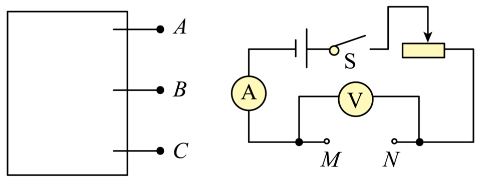

# Physics - 题目 128

**ID**: ce141f2a714d48a8995bb457b5a4f590
**年级**: Grade 9
**难度**: Medium-Hard
**题型**: Comprehensive

## 题目
物理老师给同学们展示一个如图所示的黑盒子，盒内由两个定值电阻连接而成，从盒内引出三根导线接在A、B、C三个接线柱。​​​​​​​‌用图所示的电路来研究黑盒内电阻的连接情况，电压表指针无法调零，只能准确读出电压的变化。已知电源电压恒定不变，老师进行了如下的实验操作，请你解答相关的问题：（1）把A、C两个接线柱接到M、N之间，将滑动变阻器的滑片移至最左端时，闭合开关S，电流表示数为I_{1}；将滑片移至最右端时，电流表示数为2I_{1}，整个过程中电压表的示数变化了∆U，求电源电压；（2）先用导线把A、B接线柱连接起来，再将A、C接线柱接入M、N之间，将滑动变阻器的滑片移至最右端，闭合开关S，此时电流表的示数为6I_{1}。请结合（1）（2）的实验操作通过推理计算，在图中画出黑盒子内两个电阻的连接情况，并标明各电阻的阻值（用已知量表示）；（3）请你说出两种使通电螺线管磁性增强的措施：①；②。

## 解答

1. （1）[1]把A、C两个接线柱接到M、N之间时，接入电路的电阻为R_{AC}。将滑动变阻器的滑片移至最左端时，此时滑动变阻器以最大阻值接入电路，闭合开关S，电流表示数为I_{1}，根据欧姆定律和串联电路电压特点可得
2. I_{1}R_{AC}+I_{1}R_{滑}=U①
3. 将滑片移至最右端时，此时滑动变阻器接入电路的阻值为0，电流表示数为2I_{1}，根据欧姆定律可得
4. 2I_{1}R_{AC}=U②
5. 整个过程中电压表的示数变化了∆U，则有
6. 2I_{1}R_{AC}-I_{1}R_{AC}=∆U③
7. 由③得
8. $R{{}_{{\rm{A}}{\rm{C}}}}=\frac {\Delta U}{I{{}_{1}}}$ ④
9. 把④代入②可得
10. U=2∆U⑤
11. 把④⑤代入①得
12. $R{{}_{滑}}=\frac {\Delta U}{I{{}_{1}}}$
13. 由上述计算可知，电源电压为2∆U。
14. （2）[2]先用导线把A、B接线柱连接起来，再将A、C接线柱接入M、N之间，此时接入电路的电阻为R'_{AC}。将滑动变阻器的滑片移至最右端，滑动变阻器接入电路的阻值为0，闭合开关S，此时电流表的示数为6I_{1}。根据欧姆定律可得
15. 6I_{1}R'_{AC}=U=2∆U
16. 解得
17. $R{^{^{′}}}{{}_{{\rm{A}}{\rm{C}}}}=\frac {2\Delta U}{6I{{}_{1}}}=\frac {\Delta U}{3I{{}_{1}}}$
18. 所以有R_{AC}>R'_{AC}，即用导线把A、B接线柱连接起来后，A、C间的电阻变小。因为盒内只有两个定值电阻，所以盒内两个电阻串联。盒内两个电阻的阻值分别为
19. $R{{}_{{\rm{B}}{\rm{C}}}}=R{^{^{′}}}{{}_{{\rm{A}}{\rm{C}}}}=\frac {\Delta U}{3I{{}_{1}}}$
20. $R{{}_{{\rm{A}}{\rm{B}}}}=R{{}_{{\rm{A}}{\rm{C}}}}-R{{}_{{\rm{B}}{\rm{C}}}}=\frac {\Delta U}{I{{}_{1}}}-\frac {\Delta U}{3I{{}_{1}}}=\frac {2\Delta U}{3I{{}_{1}}}$
21. 黑盒子内两个电阻的连接情况，如图所示：
22. 
23. （3）[3][4]通电螺线管磁性的强弱与电流大小、线圈匝数、有无铁芯等有关。因而使通电螺线管磁性增强的措施：①增加线圈的匝数；②增大电流。

## 知识点

**中文**:
  - 影响电磁铁磁性强弱的因素
  - 欧姆定律的应用
  - 电路的动态分析

**English**:
  - Factors Affecting Electromagnet Strength
  - Applications of Ohm's Law
  - Dynamic Circuit Analysis

---
