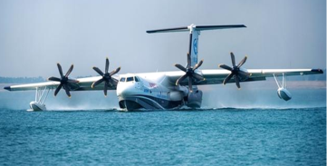

# Physics - 题目 2855

**ID**: d5d19e8c8f334d5db3861c5bdedb2740
**年级**: Grade 9
**难度**: Medium-Hard
**题型**: Comprehensive

## 题目
国产大型水陆两栖飞机AG600可在水面直接起飞，主要用于森林灭火和水上救援。​​​​​​​‌空载时的总质量为41.5t，水上滑行中一次最多可汲水12t，最快仅需20s；（1）飞机机翼横截面的形状上下不对称，呈明显的弧度结构，可使飞机在飞行过程中机翼上表面的空气流速大，压强（选填“大”或“小”），从而形成向上的升力，此次装配在AG600上的四台国产的涡桨6发动机，在飞行时，发动机向后高速喷出燃烧气体，螺旋桨高速旋转，飞机便向前运动，这表明。国产的涡桨6发动机的热效率和推进效率都较高，所谓热效率是指发动机获得的机械能W_{机}与燃料完全燃烧产生的内能Q_{放}之比，而推进效率是指发动机传递给飞机的推力所做的功W_{推}与其获得的机械能W_{机}之比，若飞机在空中飞行时获得9×10^{4}N的水平推力，以560km/h的速度沿水平方向匀速航行1h，需要完全燃烧热值为4.5×10^{7}J/kg的航空煤油4t，则在这1h内：（2）煤油完全燃烧放出的热量为多大？（3）水平推力对飞机做的功多大？（4）若该发动机的推进效率是80%，则其热效率为多大？

## 解答

1. （1）[1] 飞机机翼横截面的形状上下不对称，呈明显的弧度结构，可使飞机在飞行过程中机翼上表面的空气流速大，压强小，下表面流速小，压强大，从而形成向上的压力差，即升力。
2. [2] 在飞行时，发动机向后高速喷出燃烧气体，根据力的作用是相互的，燃气对飞机的反作用力推动飞机向前运动。
3. （2）[3]煤油完全燃烧放出的热量为
4. Q_{放}=mq= 4000kg×4.5× 10^{7}J/kg= 1.8 × 10^{11}J
5. （3）[4]飞机通过的距离为
6. s=vt= 560km/h ×1h= 560km= 5.6 ×10^{5}m
7. 推力所做的功为
8. W_{推}=Fs= 9×10^{4}N×5.6×10^{5}m= 5.04× 10^{10}J
9. （4）[5]据题意：推进效率
10. η1=W推W机×100%
11. 所以
12. ${\rm W{{}_{机}}=\frac {5.04\times 10{^{10}}{\rm{J}}}{0.8}=6.3\times 10{^{10}}{\rm{J}}}$
13. 热效率
14. ${\rm η{{}_{2}}=\frac {W{{}_{机}}}{Q}\times 100\%=\frac {6.3\times 10{^{10}}{\rm{J}}}{1.8\times 10{^{11}}{\rm{J}}}\times 100\%=35\%}$

## 知识点

**中文**:
  - 力的作用是相互的
  - 速度公式及其应用
  - 流体压强与流速的关系
  - 功的计算和估算
  - 热值及相关计算
  - 热效率的计算

**English**:
  - Interaction of Forces
  - Velocity Formula and Applications
  - Relationship between Fluid Pressure and Flow Speed
  - Calculation and Estimation of Work
  - Calorific Value and Calculations
  - Calculation of Thermal Efficiency

---
