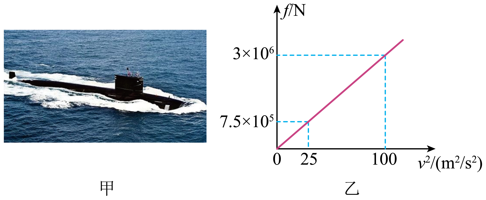

# Physics - 题目 476

**ID**: d65543dfa0584833a609b574bc7d2b98
**年级**: Grade 9
**难度**: Medium-Hard
**题型**: Comprehensive

## 题目
核潜艇庆祝中国人民解放军海军成立70周年海上阅兵活动在青岛附近海域举行，图甲中为093改进型攻击核潜艇公开亮相并进行了战略巡航。​​​​​​​‌我国某核潜艇H最大潜深350m，完全下潜到海面下后的排水量为8.24×10^{3}t。潜艇内部有水舱，通过向水舱中充水或从水舱中向外排水来改变潜艇的自重，从而控制其下沉或上浮。已知海水密度ρ_{海}为1.03×10^{3}kg/m^{3}，江水密度ρ_{江}为1.0×10^{3}kg/m^{3}，取g＝10N/kg，不考虑潜艇的体积变化。（1）下列关于核潜艇的说法中，正确的是；

## 解答

1. （1）[1]A．核潜艇在水下需要承担较大的压强，所以潜水艇的外壳用硬度大的特种钢材制成的，故A错误；
2. B．核潜艇是通过改变自身重力达到浮沉的，故B错误；
3. C．核潜艇悬浮和漂浮时排开水的体积不相同，根据 $F{{}_{浮}}＝ρgV{{}_{排}}$ 知所受的浮力不相等，故C错误；
4. D．核潜艇由东海海面下潜行进入长江后，液体的密度减小，根据 $F{{}_{浮}}＝ρgV{{}_{排}}$ 知所受的浮力变小，故D正确；
5. 故选D。
6. （2）[2]核潜艇在海面下水平匀速巡航时，突然进入密度跃层（海水密度突然变小）时，海水跃层是上层密度大、下层密度小，因此由 $F{{}_{浮}}＝ρgV{{}_{排}}$ 可知，会造成潜艇受到的浮力减小，浮力小于重力，所以潜水艇会突然下沉。
7. [3]因为潜水艇是靠改变自身的重力实现浮沉的，所以此时将潜艇水舱向外排水，使潜艇受到的重力小于浮力，实现上浮。
8. （3）[4]该核潜艇H悬浮在海面下时，螺旋桨将海水推向后方，由于物体间力的作用是相互的，海水对螺旋桨施加一个向前的力，核潜艇就前进了。
9. [5]由图乙可知，当风速的平方为100m^{2}/s^{2}时，核潜艇受到的阻力f＝3×10^{6}N，
10. 当核潜艇H航速为8m/s时，核潜艇H所受的海水阻力为
11. $f\prime ＝\frac {{\rm{(}}{\rm{8}}{\rm{m}}{\rm{/}}{\rm{s}}{\rm{)}}{^{{\rm{2}}}}}{{\rm{1}}{\rm{0}}{\rm{0}}{\rm{m}}{^{{\rm{2}}}}{\rm{/}}{\rm{s}}{^{{\rm{2}}}}}\times 3\times 10{^{6}}{\rm{N}}＝1.92\times 10{^{6}}{\rm{N}}$

## 知识点

**中文**:
  - 力的作用是相互的
  - 物质的物理属性
  - 阿基米德原理的应用
  - 物体的浮沉条件及其应用

**English**:
  - Interaction of Forces
  - Physical Properties of Matter
  - Applications of Archimedes' Principle
  - Floating/Sinking Conditions and Applications

---
