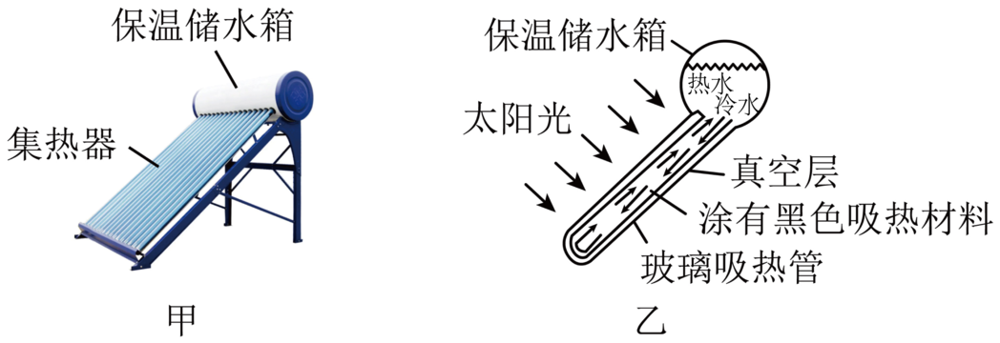

# Physics - 题目 2177

**ID**: dc91afec6d5843a2bd83af711f7f21e8
**年级**: Grade 9
**难度**: Medium-Hard
**题型**: Comprehensive

## 题目
阅读下面的短文，回答问题太阳能热水器太阳能热水器能利用太阳能把水从低温加热到高温，以满足人们日常生活的需要，它具有安全、节能、环保等优点，如图甲所示，太阳能热水器主要由两部分构成：一部分是由许多根玻璃吸热管组成的集热器，每根玻璃吸热管由双层玻璃管组成，双层玻璃管之间是真空，真空不利于热量的传递。​​​​​​​‌如图乙所示是玻璃吸热管的工作原理图，它的结构与保温瓶的玻璃内胆相似，只是在玻璃吸热管的内表面涂了一层黑色的吸热材料；另一部分是保温储水箱，保温储水箱下部与玻璃吸热管相通。请回答以下问题：（1）当太阳光入射到黑色的吸热层上时，黑色吸热层能把太阳能更有效地转化为能，将管内的水加热。这是通过的方式改变内能，玻璃吸热管内向光一侧的水吸热后体积增大、密度（选填“变大”、“不变”或“变小”）；（2）这台太阳能热水器的水箱容积为120L，那么水箱内装满水时，在一般的光照条件下，太阳能每天可将满箱20℃的水加热到70℃，则水吸收的热量为J；[水的比热容是4.2×10^{3}J（kg·℃）]（3）如果热水器上的集热器对太阳能的利用效率为40%，在与阳光垂直的地球表面上每平方米得到的太阳辐射功率约为P=1400W。如果将整箱水的温度从20℃加热到70℃，需要阳光照射5h，那么热水器上集热器的面积至少要是m^{2}。

## 解答

1. （1）[1][2]当太阳光入射到黑色的吸热层上时，黑色吸热层能把太阳能更有效地转化为内能，水吸热，温度升高内能增大，属于通过热传递的方式改变内能。
2. [3]玻璃吸热管内向光一侧的水吸热后体积增大，质量不变，根据 $ρ{\rm{=}}\frac {m}{V}$ 可得，密度变小。
3. （2）[4]水箱里的水的体积为
4. $V{{}_{水}}{\rm{=}}{\rm{1}}{\rm{2}}{\rm{0}}{\rm{L}}{\rm{=}}{\rm{1}}{\rm{2}}{\rm{0}}{\rm{d}}{\rm{m}}{^{{\rm{3}}}}{\rm{=}}{\rm{0}}{\rm{.}}{\rm{1}}{\rm{2}}{\rm{m}}{^{{\rm{3}}}}$
5. 水的质量为
6. $m{{}_{水}}{\rm{=}}ρ{{}_{水}}V{{}_{水}}{\rm{=}}{\rm{1}}{\rm{.}}{\rm{0}}{\rm{×}}{\rm{1}}{\rm{0}}{^{{\rm{3}}}}{\rm{k}}{\rm{g}}{\rm{/}}{\rm{m}}{^{{\rm{3}}}}{\rm{×}}{\rm{0}}{\rm{.}}{\rm{1}}{\rm{2}}{\rm{m}}{^{{\rm{3}}}}{\rm{=}}{\rm{1}}{\rm{2}}{\rm{0}}{\rm{k}}{\rm{g}}$
7. 水吸收的热量为
8. $Q{{}_{吸}}{\rm{=}}cm{{}_{水}}（t{\rm{-}}t{{}_{{\rm{0}}}}）{\rm{=}}{\rm{4}}{\rm{.}}{\rm{2}}{\rm{×}}{\rm{1}}{\rm{0}}{^{{\rm{3}}}}{\rm{J}}{\rm{/}}（{\rm{k}}{\rm{g}}⋅℃）{\rm{×}}{\rm{1}}{\rm{2}}{\rm{0}}{\rm{k}}{\rm{g}}{\rm{×}}（{\rm{7}}{\rm{0}}℃{\rm{-}}{\rm{2}}{\rm{0}}℃）{\rm{=}}{\rm{2}}{\rm{.}}{\rm{5}}{\rm{2}}{\rm{×}}{\rm{1}}{\rm{0}}{^{{\rm{7}}}}{\rm{J}}$
9. （3）[5]假设集热器的面积为S，这台太阳能热水器获得的辐射功率为
10. $P{{}_{太}}{\rm{=}}S{\rm{×}}{\rm{1}}{\rm{4}}{\rm{0}}{\rm{0}}{\rm{W}}{\rm{/}}{\rm{m}}{^{{\rm{2}}}}$
11. 由 $P{\rm{=}}\frac {W}{t}$ 可得，太阳照射5h获得的太阳能为
12. $W{{}_{总}}{\rm{=}}P{{}_{太}}t{\rm{=}}S{\rm{×}}{\rm{1}}{\rm{4}}{\rm{0}}{\rm{0}}{\rm{W}}{\rm{/}}{\rm{m}}{^{{\rm{2}}}}{\rm{×}}{\rm{5}}{\rm{×}}{\rm{3}}{\rm{6}}{\rm{0}}{\rm{0}}{\rm{s}}$
13. 由 $η{\rm{=}}\frac {W{{}_{有}}}{W{{}_{总}}}$ 可得
14. $Q{{}_{吸}}{\rm{=}}W{{}_{有}}{\rm{=}}W{{}_{总}}{\rm{×}}{\rm{4}}{\rm{0}}{\rm{\%}}{\rm{=}}P{{}_{太}}t{\rm{=}}S{\rm{×}}{\rm{1}}{\rm{4}}{\rm{0}}{\rm{0}}{\rm{W}}{\rm{/}}{\rm{m}}{^{{\rm{2}}}}{\rm{×}}{\rm{5}}{\rm{×}}{\rm{3}}{\rm{6}}{\rm{0}}{\rm{0}}{\rm{s}}{\rm{×}}{\rm{4}}{\rm{0}}{\rm{\%}}$
15. 因此热水器集热器的面积为
16. $S{\rm{=}}\frac {Q{{}_{吸}}}{{\rm{1}}{\rm{4}}{\rm{0}}{\rm{0}}{\rm{W}}{\rm{/}}{\rm{m}}{^{{\rm{2}}}}{\rm{×}}{\rm{5}}{\rm{×}}{\rm{3}}{\rm{6}}{\rm{0}}{\rm{0}}{\rm{s}}{\rm{×}}{\rm{4}}{\rm{0}}{\rm{\%}}}{\rm{=}}\frac {{\rm{2}}{\rm{.}}{\rm{5}}{\rm{2}}{\rm{×}}{\rm{1}}{\rm{0}}{^{{\rm{7}}}}{\rm{J}}}{{\rm{1}}{\rm{4}}{\rm{0}}{\rm{0}}{\rm{W}}{\rm{/}}{\rm{m}}{^{{\rm{2}}}}{\rm{×}}{\rm{5}}{\rm{×}}{\rm{3}}{\rm{6}}{\rm{0}}{\rm{0}}{\rm{s}}{\rm{×}}{\rm{4}}{\rm{0}}{\rm{\%}}}{\rm{=}}{\rm{2}}{\rm{.}}{\rm{5}}{\rm{m}}{^{{\rm{2}}}}$

## 知识点

**中文**:
  - 太阳能热水器中的热量计算
  - 热传递改变物体内能
  - 太阳能的其他相关计算

**English**:
  - Heat Calculations in Solar Water Heaters
  - Changing Internal Energy by Heat Transfer
  - Other Calculations Related to Solar Energy

---
