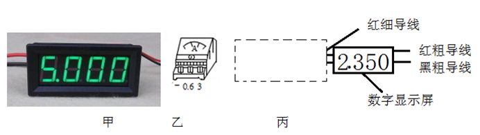

# Physics - 题目 2224

**ID**: dcd019d079484bdb9ee09e8f63c8970e
**年级**: Grade 9
**难度**: Medium-Hard
**题型**: Comprehensive

## 题目
亲爱的同学们，请你用应用所学的物理知识尝试回答下列问题：(1)初中阶段学习了很多测量仪器，其中测量电压的仪器名称是：，测量液体体积的仪器名称是：。​​​​​​​‌(2)①如图所示，其中甲为数字显示电流表(单位为A)，乙为学生用电流表，相比而言数字显示电流表具有的优点是：；。②数字电流表表头需要进行组装才能使用，两根细导线(分别为电流流入红导线、电流从黑导线流出)外接一个9V电池给表头数显供电，为了方便使用和存放此部分还应安装控制通断的；两根粗导线(分别为电流流入红导线、电流从黑导线流出)连接到待测电路中，做好的数字电流表应与被测电器联。③请在图丙的虚线框中画出数显电流表供电电路图。

## 解答

1. (1)[1][2]电压表是测量电压的仪器，量筒(量杯)是测量液体体积的仪器。
2. (2)①[3][4]数字显示电流表的优点是测量准确和读数方便。
3. ②[5][6]使用电流表时，为了方便使用和存放此部分还应安装开关。由电流表的使用方法可知，数字电流表应与被测电器串联，电流流入红导线、电流从黑导线流出。
4. ③[7]数显电流表需要9V电池给表头数显供电，开关控制电路的通断，如图所示：
5. 

## 知识点

**中文**:
  - 电压表的使用
  - 量筒(杯)的选择和使用
  - 电流表的使用

**English**:
  - Using a Voltmeter
  - Selection and Use of Graduated Cylinder
  - Using an Ammeter

---
