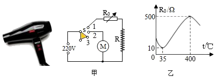

# Physics - 题目 2344

**ID**: eee3aaecfa2c4aa4bf251fa050c4a766
**年级**: Grade 9
**难度**: Medium-Hard
**题型**: Comprehensive

## 题目
甜甜要制作一个电动航模，需要电动机作为动力源，她找来电吹风，研究了电吹风的工作原理。​​​​​​​‌如图甲，电吹风工作时，可以分别吹出热风和冷风，为了防止温度过高，用一个PTC电阻R_{0}与电阻为50Ω的电热丝R串联，R_{0}的阻值随温度的变化如图乙所示，请回答下列问题：(1)PTC电阻是由材料制成的；电动机的工作原理是；(2)电吹风吹热风时，求电热丝的最大发热功率；(3)电吹风吹冷风时，通过电动机的电流为1A，工作20s，电动机的机械效率为90%，求电动机线圈电阻。(不计机械摩擦损耗的能量)

## 解答

1. (1)[1]由图乙可知，PTC电阻R_{0}的阻值随温度的变化而变化，是由半导体材料制成的。
2. [2]电动机的工作原理是：通电导体在磁场中受到力的作用。
3. (2)[3]由图乙可知，R_{0}的最小阻值为10Ω，此时电热丝支路的总电阻最小，该支路中的电流最大，电热丝的发热功率最大，因串联电路中总电阻等于各分电阻之和，所以，电热丝支路中的电流
4. I_{大}= $\frac {U}{R+R{{}_{0}}}$ = $\frac {220{\rm{V}}}{50{\rm{Ω}}+10{\rm{Ω}}}$ = $\frac {11}{3}$ A
5. 则电热丝的最大发热功率
6. P_{热}＝I_{大}^{2}R＝（ $\frac {11}{3}$ A）^{2}×50Ω≈672.2W
7. 电热丝的最大发热功率为672.2W。
8. (3)[4]电吹风吹冷风时，通过电动机的电流为1A，工作20s，消耗的电能
9. W_{电}＝UIt＝220V×1A×20s＝4400J
10. 由η＝ $\frac {W{{}_{机械}}}{W{{}_{电}}}$ ×100%可得，输出的机械能
11. W_{机械}＝W_{电}η＝4400J×90%＝3960J
12. 电动机线圈电阻产生的热量
13. Q＝W_{电}﹣W_{机械}＝4400J﹣3960J＝440J
14. 由Q＝I^{2}Rt可得，电动机线圈的电阻
15. R_{线圈}＝ $\frac {Q}{I{^{2}}t}$ ＝ $\frac {440{\rm{J}}}{{\left({1{\rm{A}}}\right)^{2}}\times 20{\rm{s}}}$ ＝22Ω
16. 电动机线圈电阻为22Ω。
17. 答：(1)PTC电阻是由半导体材料制成的；电动机的工作原理是通电导体在磁场中受到力的作用；
18. (2)电吹风吹热风时，电热丝的最大发热功率为672.2W；
19. (3)电动机线圈电阻为22Ω。

## 知识点

**中文**:
  - 利用电流的热效应工作的用电器
  - 半导体的特点与应用
  - 电功率的计算及应用
  - 直流电动机的原理
  - 非纯电阻电路的相关计算

**English**:
  - Appliances Using Heating Effect
  - Characteristics and Applications of Semiconductors
  - Calculation and Application of Electric Power
  - Principle of DC Motor
  - Calculations for Non-Pure Resistive Circuits

---
