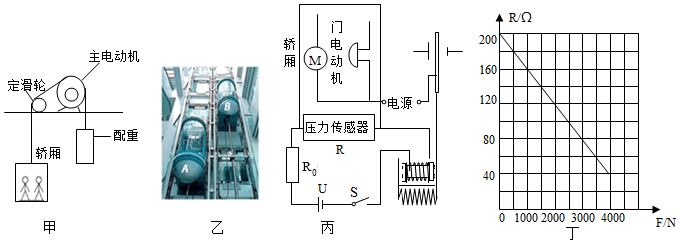

# Physics - 题目 1963

**ID**: f0b0b13d5b104254bbc507480179eef8
**年级**: Grade 9
**难度**: Medium-Hard
**题型**: Comprehensive

## 题目
阅读短文，回答问题：观光电梯电梯是一种用于多层建筑乘人或载物的运输工具。​​​​​​​‌电梯的简易结构如图甲所示。电梯轿厢和配重分别挂在主电动机的两侧，在电梯半载时，轿厢总重和配重的重力基本相等。满载上升时，主电动机提供动力，驱动轿厢。如图乙所示，为某商业大厦安装的观光电梯，其相关参数如上表。为了安全，电梯设置了超载自动报警系统，其工作原理如图丙所示。控制电路的电源电压U为12V，压力传感器的电阻R与所受压力F的关系图象如图丁所示，电磁继电器阻值可忽略。当电流大于0.2A时，会启动警报系统，同时无论如何按压电梯控制器，门电动机均不工作。此外，电梯需经常保养，“运行频次比ω”是电梯养护的重要指标，ω一般用电梯每天平均待机时间与运行时间之比来表示。(1)为便于观光，电梯的外壁采用玻璃材料，主要是因为玻璃有较好的性。该观光电梯配重的重力约为N。（g＝10N/kg）(2)下列有关该电梯的说法中，正确的是。

## 解答

1. (1)[1]乘客在随电梯竖直上升的过程中，可透过玻璃欣赏到楼外美丽的城市景色，所以为便于观光，电梯的外壁采用玻璃材料，主要是因为玻璃有较好的透光性。
2. [2]轿厢的重力为
3. G_{轿厢}＝mg＝500kg×10N/kg＝5000N
4. 电梯半载时
5. G_{半载}=12G_{最大}=12×4000N＝2000N
6. 由题意知，配重的重力
7. G_{配}＝G_{轿厢}+G_{半载}＝5000N+2000N＝7000N
8. (2)[3]A．主电机与钢丝绳之间的摩擦使钢丝绳上升，该摩擦属于有益摩擦，故A错误；
9. B．超载自动报警系统报警时，电流从电磁铁的右端导线流入，利用安培定则判断出电磁铁的右端为N极，左端为S极，故B错误；
10. C．电梯满载上行时，钢丝绳对轿厢由向上的拉力，所以电动机需顺时针转动对其产生向上的摩擦力，故C正确；
11. D．报警电铃的工作原理是电的磁效应，故D错误。
12. 故选C。
13. (3)[4][5]当站在上升的B电梯里的乘客看到A电梯在上升，此时B电梯里的乘客以自己的电梯为参照物，可推知A电梯在 上升，且速度大于B电梯的速度。
14. (4)[6]①由题意可知，当电梯超载时，压力增大，控制电路电阻减小，电磁铁的磁性增强，将衔铁吸向左侧，动触点与左侧触电接触，电铃所在的电路接通，电铃工作，发出报警声；当电梯未超载时，压力较小，控制电路电阻较大，电磁铁的磁性较弱，在弹簧的作用下，动触点与右侧触电接触，电动机所在的电路接通，电动机工作，电梯正常运行；电路如图所示：
15. 。
16. [7]②当电梯刚好满载时，即压力传感器所受压力F＝G_{最大}＝4000N；由图象可知，压力传感器的电阻R＝40Ω，由欧姆定律得，电路总电阻为
17. $R{{}_{总}}=\frac {U}{I}=\frac {{\rm{1}}{\rm{2}}{\rm{V}}}{{\rm{0}}{\rm{.}}{\rm{2}}{\rm{A}}}={\rm{2}}{\rm{4}}{\rm{Ω}}$
18. 根据串联电路电阻特点可知，R_{0}的阻值为
19. R_{0}＝R_{总}﹣R＝60Ω﹣40Ω＝20Ω
20. [8]当电梯未满载时，压力传感器所受压力变小，由图象可知，压力传感器的电阻变大，由于电梯报警时的电流和电源电压不变，根据 $R{{}_{总}}=\frac {U}{I}$ 可知，电路总电阻不变，则说明R_{0}的阻值变小。
21. (5)[9]由 $P=\frac {W}{t}$ 得，电梯运行消耗的电能为
22. W_{运行}＝P_{额}t_{运行}＝25kW×t_{运行}
23. 电梯待机消耗的电能为
24. W_{待机}＝P_{待机}t_{待机}＝1kW×t_{待机}
25. 则电梯平均每天消耗的电能为
26. W＝W_{运行}+W_{待机}
27. 即
28. 25kW×t_{运行}+1kW×t_{待机}＝72kW•h
29. t_{运行}+t_{待机}＝12h
30. 联立可解得
31. t_{运行}＝2.5h，t_{待机}＝9.5h
32. 则该观光电梯的“运行频次比”为
33. $ω=\frac {t{{}_{待机}}}{t{{}_{运行}}}=\frac {{\rm{9}}{\rm{.}}{\rm{5}}{\rm{h}}}{{\rm{2}}{\rm{.}}{\rm{5}}{\rm{h}}}=3.8$

## 知识点

**中文**:
  - 安培定则及其应用
  - 物质的物理属性
  - 欧姆定律的应用
  - 电功与电能的计算
  - 电流的磁效应

**English**:
  - Ampere's Rule and Applications
  - Physical Properties of Matter
  - Applications of Ohm's Law
  - Calculation of Electric Work and Energy
  - Magnetic Effect of Current

---
