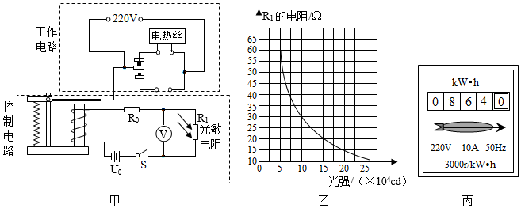

# Physics - 题目 138

**ID**: f0c5f690d69f4688b5838104ddf55f9f
**年级**: Grade 9
**难度**: Medium-Hard
**题型**: Comprehensive

## 题目
为了在光照较弱时，某太阳能热水器能利用电能加热以保证正常用水，其内部电路如图甲所示。​​​​​​​‌控制电路电源电压U_{0}为12V，定值电阻R_{0}阻值为10Ω，电磁继电器线圈电阻不计，光敏电阻R_{1}阻值随光强的减小而增大，如图乙所示（“光强”表示光强弱的程度，照射光越强，光强越大，单位为cd）。当控制电路中线圈的电流小于或等于0.3A时，弹簧将衔铁拉起，工作电路接通，电热丝工作。（1）根据安培定则判断，电磁继电器螺线管的下端为极。（2）当光强在什么范围时，工作电路工作？（3）工作电路中的电热丝上标有“220V 2000W”字样，若电热丝正常工作10min，其消耗的电能能使如图丙所示电能表表盘转多少圈？（4）为了满足家庭不同成员随时要用热水的需求，需要在不同光照强度根据个人需求控制工作电路的通断。请你提出一种方便可行的改进方案。

## 解答

1. （1）[1]根据安培定则，右手握住螺线管，四指指向电流的方向，大拇指指向螺线管的下端，则电磁铁下端为N极，上端为S极。
2. （2）[2]由题意可知，当控制电路中线圈的电流小于或等于0.3A时，弹簧将衔铁拉起，工作电路接通，电热丝工作，控制电路中的总电阻
3. R_{总}≥ $\frac {U{{}_{0}}}{I}=\frac {12{\rm{V}}}{0.3{\rm{A}}}$ ＝40Ω
4. 控制电路中R_{0}、R_{1}串联，因串联电路中总电阻等于各分电阻之和，所以，光敏电阻的阻值范围
5. R_{1}＝R_{总}﹣R_{0}≥40Ω﹣10Ω＝30Ω
6. 由图像可知，对应的光照强度小于或等于
7. 10×10^{4}cd＝1×10^{5}cd
8. 时，工作电路工作。
9. （3）[3]已知电热丝功率
10. P＝2000W＝2kW
11. 正常工作时间
12. t＝10min＝ $\frac {1}{6}$ h
13. 电热丝正常工作10min消耗的电能
14. W＝Pt＝2kW× $\frac {1}{6}$ h＝ $\frac {1}{3}$ kW·h
15. 则电能表表盘转的圈数
16. n＝W×3000r/(kW·h)＝ $\frac {1}{3}$ kW·h×3000r/(kW·h)＝1000r
17. （4）[4]因为本装置启动的电流是一定的，因此，可在电路中串联一个滑动变阻器通过改变电阻来改变电流，可以通过将控制电路的电源改为可调压电源来实现对其控制。

## 知识点

**中文**:
  - 安培定则及其应用
  - 欧姆定律的应用
  - 电能表的读数及电能的求解
  - 电功率的计算及应用
  - 电磁继电器的构造及原理

**English**:
  - Ampere's Rule and Applications
  - Applications of Ohm's Law
  - Reading Energy Meters and Calculating Energy
  - Calculation and Application of Electric Power
  - Structure and Principle of Electromagnetic Relays

---
