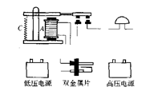

# Physics - 题目 560

**ID**: 3afbd0ad2a804545a2958577472d6e4a
**年级**: Grade 9
**难度**: Medium-Hard
**题型**: Drawing

## 题目
如图所示为电磁继电器自动报警器的电路结构图，其中“双金属片”是在受热膨胀时能自动接通电路的装置．要求做到起火后能通过电铃报警，请完成电路的连接．​​​​​​​‌

## 解答

1. 解答：
2. 起火后，双金属片在受热膨胀时自动接通电路，使控制电路接通后，电磁铁有了磁性，吸引衔铁，带动工作电路中的动静触点接通，工作电路接通，导致电铃响而报警．
3. 故连接电路如下：
4. 

## 知识点

**中文**:
  - 电磁继电器的构造及原理

**English**:
  - Structure and Principle of Electromagnetic Relays

---
