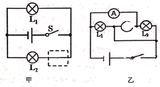

# Physics - 题目 2305

**ID**: 56bc1b740436415b92fb2e298984a023
**年级**: Grade 9
**难度**: Medium-Hard
**题型**: Drawing

## 题目
请按要求完成下列作图：(1)如图甲所示，闭合开关S后，请在图中虚线框内标出导线中电流的方向。​​​​​​​‌(2)如图乙所示，开关闭合后，请在空白圆圈里填入合适的电表符号“A”（电流表）或“V”（电压表），使两盏灯都发光。

## 解答

1. (1)[1]在电源外部，电流从电源正极出发，经各用电器再回到负极，如图甲所示，闭合开关S后两个灯泡并联，导线中电流的方向如图所示：
2. 。
3. (2)[2]电流表相当于导线，电压表相当于断开，如图乙所示，开关闭合后，两盏灯都发光时如图所示：
4. 。

## 知识点

**中文**:
  - 电压表的使用
  - 电流的方向

**English**:
  - Using a Voltmeter
  - Direction of Electric Current

---
