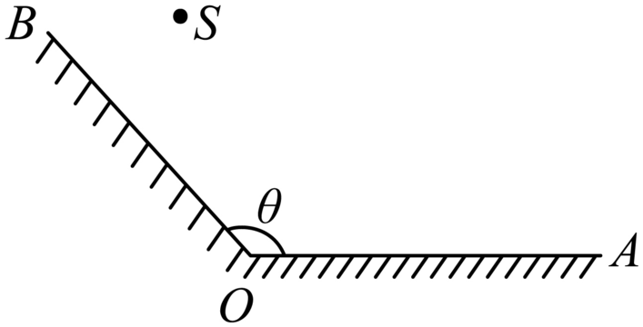

# Physics - 题目 2276

**ID**: ee7febbf03194f6d851699c50c7e14b0
**年级**: Grade 9
**难度**: Medium-Hard
**题型**: Drawing

## 题目
如图所示，两平面镜OA、OB夹角为θ，镜前有一个点光源S，试根据光路图表示出能同时看到两个像的空间范围。​​​​​​​‌

## 解答

1. S_{1}是S在平面镜OB内所成的像（一次成像），S_{2}是S在平面镜OA内所成的像（二次成像），S_{3}是S在平面镜OA内所成的像（一次成像）；由图可见，I区只能看到像S_{1}，II区能看到像S_{1}和S_{3}，III区能看到像S_{1}、S_{2}和S_{3}，Ⅳ区只能看到像S_{1}，V区能看到像S_{1}和S_{2}。

## 知识点

**中文**:
  - 平面镜成像的相关作图

**English**:
  - Drawing Plane Mirror Ray Diagrams

---
