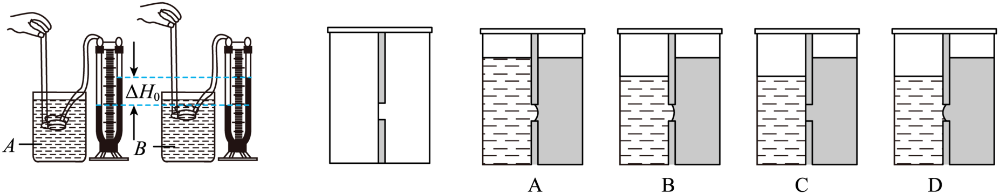

# Physics - 题目 2056

**ID**: 075968db6e6248b29722918e6766b979
**年级**: Grade 9
**难度**: Medium-Hard
**题型**: Experiment

## 题目
在同一水平桌面上的两个相同的容器中分别盛有A、B两种液体，液面相平，将两个完全相同的U形管压强计的探头分别放入液体中的不同位置，U形管内液面的高度差相同，如图所示，此时两探头上的橡皮膜所受液体压强分别为 $p{{}_{A}}$ 、 $p{{}_{B}}$ ，容器底所受液体压强分别为 $p{{}_{A}}^{′}$ 、 $p^{′}{{{}_{{\rm{B}}}}}$ ，则 $p{{}_{A}}$$p{{}_{B}}$ ， $p{{}_{A}}^{′}$$p^{′}{{{}_{{\rm{B}}}}}$ （以上均选填“>”、“=”或“<”）；小明完成上述实验后与同学经过交流又设计了一个实验装置，如图所示，容器中间用隔板分成左右两部分，隔板下部有一圆孔用橡皮膜封闭，橡皮膜两侧压强不同时，其形状发生改变。​​​​​​​‌若往隔板两侧分别加入两种不同的液体，其中不能比较两种液体密度大小关系的是（选填字母）。

## 解答

1. 根据题意可知，U形管内液面的高度差相同，则两探头上的橡皮膜所受液体压强相等，即 $p{{}_{A}}=p{{}_{B}}$ 。由图可知，探头在A液体中较深，由公式 $p=ρgh$ 可知，A液体的密度小于B液体密度，又有两烧杯中液体深度相同，则有 $p{{}_{A}}^{′}<p{{}_{B}}^{′}$ 。由图可知，橡皮膜向右突出，说明左侧压强大，但左右深度一样，由 $p=ρgh$ 可知，左侧液体密度大，能比较两种液体密度大小关系，故A不符合题意；由图可知，橡皮膜向右突出，说明左侧压强大，左侧深度小，由 $p=ρgh$ 可知，左侧液体密度大，能比较两种液体密度大小关系，故B不符合题意；由图可知，橡皮膜平整，说明两侧压强相等，但左侧深度小，由 $p=ρgh$ 可知，左侧液体密度大，能比较两种液体密度大小关系，故C不符合题意；由图可知，橡皮膜向左突出，说明右侧压强大，但右侧深度也大，所以无法比较密度大小，故D符合题意。

## 知识点

**中文**:
  - 液体压强的特点及应用
  - 液体压强计算公式的应用

**English**:
  - Characteristics and Applications of Liquid Pressure
  - Application of Liquid Pressure Formula

---
