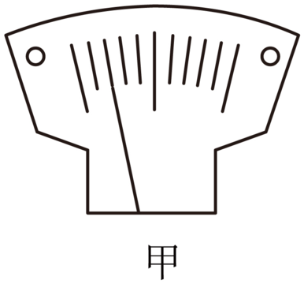
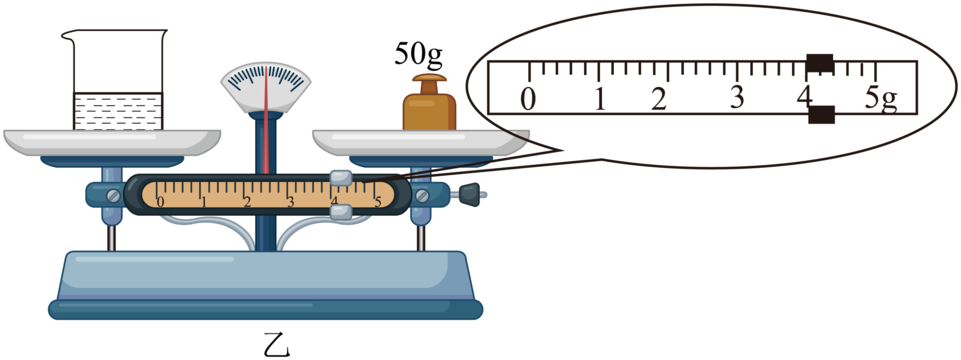
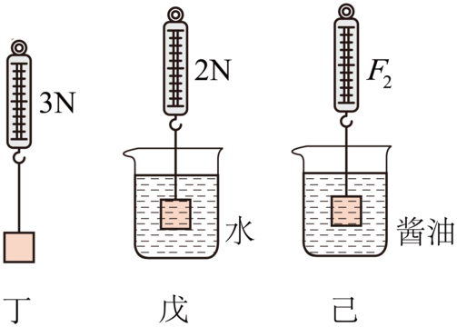

# Physics - 题目 1708

**ID**: 084666d4274f4609a574a2c67aacf74e
**年级**: Grade 9
**难度**: Medium-Hard
**题型**: Experiment

## 题目
小东想知道家中酱油的密度，于是他采用下列两种方式进行测量。​​​​​​​‌（1）他用天平和量筒进行酱油密度的测量，步骤如下：①小东将天平放置在水平桌面上，将游码移到标尺零刻度处，天平指针如图甲所示。要使天平横梁平衡，应将平衡螺母向调节；②在烧杯中倒入适量的酱油，用调好的天平测出烧杯和酱油的总质量120g；③将烧杯中的部分酱油倒入量筒中，体积如图丙所示；④再次用天平测出烧杯和剩余酱油的总质量，如图乙所示，记为g；⑤小东根据以上实验所测数据，计算出酱油的密度为kg/m^{3}；（2）经思考，小东想到用浮力相关知识也能粗略测出酱油密度，于是他找来图丁、戊、己中的实验器材，进行测量，步骤如下：①用细线系住物体，如图丁，用弹簧测力计测出该物体受到的重力G为3N，并记录；②将物体浸没在水中，如图戊，弹簧测力计示数F_{1}为2N，并记录；③再将该物体取出擦干后浸没在酱油中，如图己，弹簧测力计示数为F_{2}，并记录；④利用上述测量出的物理量和已知量，可以计算该物体浸没在水中时所受浮力为N；酱油的密度ρ_{酱油}=（用ρ_{水}、G、F_{1}、F_{2}表示）。

## 解答

1. （1）＇＇在调节托盘天平时，首先将其放在水平桌面上，游码放在标尺的左端零刻度线处，此时，若发现指针指在分度盘的中央零刻度线的左边，应将平衡螺母向右调节。
2. 由图乙可知，烧杯和剩余酱油的总质量m_{剩}=50g+4g=54g
3. 由图丙可知，倒出的酱油的体积V=60mL=60cm^{3}
4. 倒出的酱油的质量m=m_{总}-m_{剩}=120g-54g=66g
5. 酱油的密度 $ρ=\frac {m}{V}=\frac {66{\rm{g}}}{60{\rm{c}}{\rm{m}}{^{3}}}=1.1{{\rm{g}}}/{{\rm{c}}{\rm{m}}{^{3}}}=1.1\times 10{^{3}}{{\rm{k}}{\rm{g}}}/{{\rm{m}}{^{3}}}$
6. （2）根据称重法可知，物体浸没在水中时所受浮力F_{浮水}=G-F=3N-2N=1N
7. 由F_{浮}=ρ_{液}V_{排}g可得，物体排开水的体积，即物体的体积 $V=V{{}_{排}}=\frac {F{{}_{浮水}}}{ρ{{}_{水}}g}=\frac {G-F{{}_{1}}}{ρ{{}_{水}}g}$
8. 再将该物体取出擦干后浸没在酱油中，如图己，弹簧测力计示数为F_{2}，则该物体在酱油中受到的浮力F_{浮酱油}=G-F_{2}
9. 因为物体在酱油中和在水中都是全部浸没，所以V_{排酱油}=V_{排水}=V
10. 由F_{浮酱油}=ρ_{酱油}V_{排酱油}g可得，酱油的密度表达式 $ρ{{}_{酱油}}=\frac {F{{}_{浮酱油}}}{gV{{}_{排酱油}}}=\frac {G-F{{}_{2}}}{g\times \frac {G-F{{}_{1}}}{ρ{{}_{水}}g}}=\frac {G-F{{}_{2}}}{G-F{{}_{1}}}ρ{{}_{水}}$

## 知识点

**中文**:
  - 利用浮力知识测密度
  - 液体密度的测量实验
  - 特殊方法测密度

**English**:
  - Measuring Density using Buoyancy
  - Experiment: Measuring Density of Liquids
  - Special Methods for Measuring Density

---
