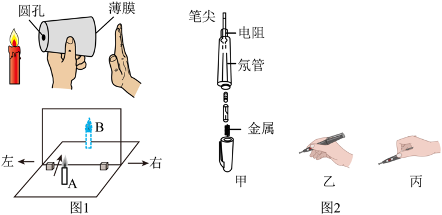

# Physics - 题目 1964

**ID**: 0a99b8341ccc48bb8bd05ddbc7e2dfcd
**年级**: Grade 9
**难度**: Medium-Hard
**题型**: Experiment

## 题目
小明买了蜡烛做以下物理小实验：（1）如图甲，小明在纸杯底部开一圆孔，用塑料薄膜蒙住杯口，拍打薄膜发出声音，烛焰晃动，说明声音。​​​​​​​‌（2）如图乙，小明用该蜡烛“探究平面镜成像的特点”时，将点燃的蜡烛A放在玻璃板前面，能看到玻璃板后面有它的像，小明拿一只与A完全相同的蜡烛B在玻璃板后面移动，直至蜡烛B与蜡烛A的像完全重合。这种确定像与物大小的方法是（选填“转换法”、“控制变量法”或“等效替代法”）；小明用吸管沿着图示方向对着蜡烛A的左侧吹气，他将看到A烛焰的像向（选填“左”或“右”）偏。（3）如图所示是使用测电笔时的情况：图甲测电笔的笔尖应该是（选填“导体”或“绝缘体”）；在图乙和图丙中，表示正确使用测电笔的是图；若测电笔氖管发光放电时的电流为0.4mA，人体的安全电压为36V，则当测电笔的笔尖接触家庭电路的火线时要使人能处于安全状态，测电笔内电阻至少需。（只考虑人体和测电笔的电阻）

## 解答

1. （1）[1]小明在纸杯底部开一圆孔，用塑料薄膜蒙住杯口，拍打薄膜发出声音，烛焰晃动，烛焰的状态发生了改变，说明声音能传递能量。
2. （2）[2]两支蜡烛大小相同，后面的蜡烛又和前面蜡烛的像完全重合，这样就证明了像与物大小相同，这种确定像与物大小的方法是等效替代法。
3. [3]小明用吸管沿着图示方向对着蜡烛A的左侧吹气，吹气引起烛焰左侧空气流速大，压强变小，在两侧压力差的作用下，烛焰向左侧偏，由于像与物关于镜面对称，所以他将看到A烛焰的像向左偏。
4. （3）[4]测电笔的用途是辨别火线和零线，容易导电的物体是导体，不容易导电的物体是绝缘体，笔尖金属体属于导体。
5. [5]测电笔的使用方法是使用测电笔时，手要接触测电笔尾部的金属体，笔尖接触电线，氖管发光表明接触的是火线，不发光是零线，故在图乙和图丙中，正确使用试电笔的是图丙。
6. [6]人体接触安全电压最大为36V，家庭电路的电压为220V，由于串联电路中总电压等于各分电压之和，故测电笔内电阻两端的电压最小为
7. $U{{}_{{\rm{R}}}}=U-U{{}_{人}}=220{\rm{V}}-36{\rm{V}}{\rm{=}}184{\rm{V}}$
8. 在串联电路中各处的电流相等，根据欧姆定律可得，测电笔内电阻的最小值
9. $R=\frac {U{{}_{{\rm{R}}}}}{I}=\frac {184{\rm{V}}}{0.4\times 10{^{{\rm{-}}3}}{\rm{A}}}{\rm{=}}4.6\times 10{^{5}}Ω$

## 知识点

**中文**:
  - 声与能量
  - 平面镜成像特点的探究实验
  - 测电笔的结构和使用

**English**:
  - Sound and Energy
  - Experiment: Characteristics of Plane Mirror Imaging
  - Structure and Use of Test Pen

---
