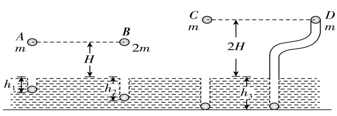

# Physics - 题目 38

**ID**: 0e063b7a3a504fa4be7274559f953dbe
**年级**: Grade 9
**难度**: Medium-Hard
**题型**: Experiment

## 题目
某同学在体育活动中，从铅球下落陷入沙坑的深度情况猜想到：物体的重力势能可能与物体的质量、下落高度和运动路径有关。​​​​​​​‌于是设计了如图所示的实验：用大小、  形状相同的 A、B、C、D四个铅球，其中 A、C、D三球的质量为m，B球质量为 2m，让A、B两球从距沙表面高H静止下落，C球从距沙表面高  2H静止下落，D球从距沙表面高 2H的光滑弯曲管道上端静止滑入，最后从管道下端竖直地落下（球在光滑管道中运动的能量损失不计）。实验测得 A、B两球陷入沙深度分别为h_{1}和h_{2}，C、D两球陷入沙深度均为h_{3}，且h_{1}＜h_{2}＜h_{3}。(1)本实验中，铅球的重力势能大小是通过来反映的。(2)比较 A、B两球，发现 B球陷入沙深度更大，由此可得出结论：当下落高度一定时，。(3)比较两球，发现 C球陷入沙中深度更大，由此可得出结论：当物体质量相同时，下落的高度越高，物体的重力势能越大。(4)比较 C、D两球，发现两球运动的路径不同，但陷入沙深度相同，由此可得出结论： 物体的重力势能与物体运动的路径（选填：“有关”或“无关”）。

## 解答

1. (1)[1]铅球重力势能越大，落下后陷入沙坑越深，所以铅球的重力势能是通过陷入沙坑深度来反映的。
2. (2)[2]A、B两球质量不同，高度相同，质量更大的B球陷入更深，说明当下落高度一定时，质量越大，重力势能越大。
3. (3)[3]A、C两球质量相等，C球下落高度更高，故C球陷入更深。所以比较A、C两球可得：当物体质量相同时，下落的高度越高，物体的重力势能越大。
4. (4)[4]当下落高度和质量相同时，虽然路径不同，但两球陷入深度相同，说明物体重力势能与其运动路径无关。

## 知识点

**中文**:
  - 探究影响物体重力势能大小因素的实验

**English**:
  - Experiment: Factors Affecting Gravitational Potential Energy

---
