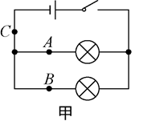
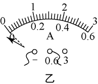
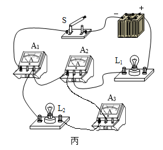

# Physics - 题目 834

**ID**: 0f6c3303098a4037a0380d60b6e1ac33
**年级**: Grade 9
**难度**: Medium-Hard
**题型**: Experiment

## 题目
小乐想探究并联电路中电流的关系，他设计的电路如图甲所示。​​​​​​​‌(1)在连接电路的过程中开关应该，电流表在接入电路前，在不清楚通过被测部分电路的电流情况下，通常要选择电流表大量程进行；(2)在实验中，小乐试触时电流表的指针偏转情况如图乙所示，根据你的分析，你认为原因可能是；(3)在实验过程中他连接了如图丙所示的电路，闭合开关后，观察到灯L_{2}不发光，分析电路连接情况，该电路存在的问题是：灯L_{2}处发生了故障。请在丙图中只改动一根导线，要求：电流表A_{1}测流过干路的电流，A_{2}测流过灯L_{1}的电流，A_{3}测流过灯L_{2}的电流；（提醒：在需要删除的导线上画“×”，用笔将改动后的导线画出，导线不许交叉）(4)排除故障后，分别测出电路中的A、B、C三处的电流，他下一步应该做的是；

## 解答

1. (1)[1]在连接电路的过程中开关应该断开。
2. [2]电流表在接入电路前，在不清楚通过被测部分电路的电流情况下，通常要选择电流表大量程进行试触。
3. (2)[3]电流表的指针偏转情况如图乙所示，指针向左偏转，原因可能是电流表正负接线柱接反了。
4. (3)[4]如图丙所示，灯L_{2}处发生了短路故障。
5. [5]正确连接应是将电流表A_{3}接电流表A_{2}负接线柱改接到灯L_{1}左侧，如下图所示：
6. 
7. (4)[6]分别测出电路中的A、B、C三处的电流，他下一步应该做的是：换用不同规格的灯泡，再测几次，得出普遍规律，故选C。
8. (5)[5]分析上表数据可得出并联电路的电流特点是：并联电路的干路电流等于各支路电流之和。

## 知识点

**中文**:
  - 探究串、并联电路的电流规律实验

**English**:
  - Experiment: Current Laws in Series/Parallel

---
