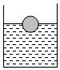

# Physics - 题目 2702

**ID**: 11808742971b46819578527c3e808d18
**年级**: Grade 9
**难度**: Medium-Hard
**题型**: Experiment

## 题目
小红做“小球放入水中静止时，水对容器底部的压强增加量 $\Delta p{{}_{水}}$ 及容器对水平面的压强增加量 $Δp{{}_{容}}$ 与哪些因素有关”的实验，她选取了体积相同、密度不同的若干小球放入水中（水深大于小球直径，且水不溢出），如图所示，测出水对容器底部的压强增加量 $\Delta p{{}_{水}}$ 及容器对水平面的压强增加量 $Δp{{}_{容}}$ ，并将相关数据记录在表一中。​​​​​​​‌表一： $ρ{{}_{水}}=1.0\times 10{^{3}}{\rm{k}}{\rm{g}}{\rm{/}}{\rm{m}}{^{{\rm{3}}}}$实验序号12345$ρ{{}_{球}}$ （×10^{3}kg/m^{3}）0.20.60.81.01.2$\Delta p{{}_{水}}$ （Pa）98294392490490$Δp{{}_{容}}$ （Pa）98294392490588①分析比较表中实验序号中的数据及相关条件可知:浸入水中体积相同的小球，当 $ρ{{}_{球}}$ 与 $ρ{{}_{水}}$ 的大小满足关系时， $\Delta p{{}_{水}}$ 与 $ρ{{}_{球}}$ 无关。②分析比较表中 $Δp{{}_{容}}$ 与 $ρ{{}_{球}}$ 的数据及相关条件可知:浸入水中的小球，。③分析比较表中实验序号1-4中 $\Delta p{{}_{水}}$ 与 $Δp{{}_{容}}$ 的大小关系及相关条件可知:浸入水中体积相同的小球，。④小明仅改变液体种类，利用上述实验器材重复了实验，得到的数据如表二所示，根据上述实验规律，分析可得小明所用液体的密度值应为kg/m^{3}。表二： $ρ{{}_{液}}$实验序号12345$ρ{{}_{球}}$ （×10^{3}kg/m^{3}）0.20.60.81.01.2$\Delta p{{}_{液}}$ （Pa）98294392490539$Δp{{}_{容}}$ （Pa）98294392490588

## 解答

1. ①[1][2]由小球的密度可知，实验序号4、5中的小球，其在水中分别是悬浮和沉底状态，故其浸入水中体积相同。故由实验序号4、5中的数据可知，浸入水中体积相同的小球，当 $ρ{{}_{球}}\geqslant ρ{{}_{水}}$ 时， $\Delta p{{}_{水}}$ 与 $ρ{{}_{球}}$ 无关。
2. ②[3]由表中数据发现，容器对水平面的压强增加量随着浸入水中小球密度的增大而增大，并且 $Δp{{}_{容}}$  与 $ρ{{}_{球}}$ 成正比。
3. ③[4]分析比较表中实验序号1-4中 $\Delta p{{}_{水}}$ 与 $Δp{{}_{容}}$ 的大小关系及相关条件可知：浸入水中体积相同的小球，当 $ρ{{}_{球}}\leqslant ρ{{}_{水}}$ 时， $Δp{{}_{水}}=Δp{{}_{容}}$ 。
4. ④[5]由两表中的数据可知，表一和表二中的序号5实验，小球均为沉底状态，由于是相同小球，故它排开水和液体的体积相同，水面上升的高度 $Δh{{}_{水}}$ 和液面上升的高度 $Δh{{}_{液}}$ 相等，容器中的水和液体对容器底部压强变化量之比为
5. $\frac {Δp{{}_{液}}}{Δp{{}_{水}}}=\frac {ρ{{}_{液}}gΔh{{}_{液}}}{ρ{{}_{水}}gΔh{{}_{水}}}=\frac {ρ{{}_{液}}}{ρ{{}_{水}}}=\frac {539{\rm{P}}{\rm{a}}}{490{\rm{P}}{\rm{a}}}=1.1$
6. 故上式可得
7. $ρ{{}_{液}}=1.1ρ{{}_{水}}=1.1\times 1.0\times 10{^{3}}{\rm{k}}{\rm{g}}{\rm{/}}{\rm{m}}{^{{\rm{3}}}}=1.1\times 10{^{3}}{\rm{k}}{\rm{g}}{\rm{/}}{\rm{m}}{^{{\rm{3}}}}$
8. 故小明所用液体的密度值应为 $1.1\times 10{^{3}}{\rm{k}}{\rm{g}}{\rm{/}}{\rm{m}}{^{{\rm{3}}}}$ 。

## 知识点

**中文**:
  - 固体压强的判断与计算
  - 液体压强的判断与计算

**English**:
  - Determination and Calculation of Solid Pressure
  - Determination and Calculation of Liquid Pressure

---
