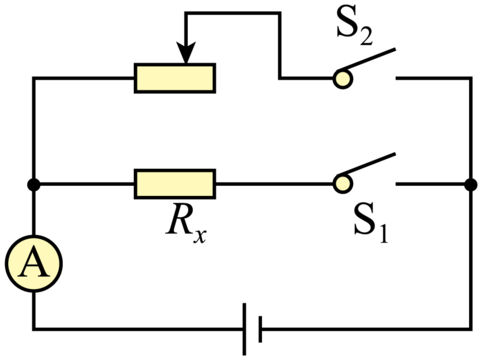

# Physics - 题目 1550

**ID**: 135fb6d3c5f84e8ba05574a61109e931
**年级**: Grade 9
**难度**: Medium-Hard
**题型**: Experiment

## 题目
利用稳压电源（电压未知）、最大阻值为R的滑动变阻器和电流表等器材，测电阻R_{x}的阻值，设计的电路如图，完成下列实验步骤：（1）正确连接电路，断开S_{1}、S_{2}，将滑动变阻器的阻值调至最大R；​​​​​​​‌（2）闭合S_{1}，断开S_{2}，读出电流表的示数为I_{1}；（3）；（4）电阻R_{x}＝（用测得量的符号表示）

## 解答

1. （1）正确连接电路，断开S_{1}、S_{2}，将滑动变阻器的阻值调至最大R；
2. （2）闭合S_{1}，断开S_{2}，读出电流表的示数为I_{1}，此为通过R_{x}的电流；
3. （3）[1]闭合S_{1}、S_{2}，读出电流表的示数为I_{2}，此为通过R与R_{x}的总电流，则R的电流为
4. $I{{}_{R}}=I{{}_{2}}-I{{}_{1}}$
5. （4）[2]根据并联电路电压的规律及欧姆定律可得
6. $U=I{{}_{1}}R{{}_{{\rm{x}}}}=\left ({I{{}_{2}}-I{{}_{1}}}\right )R$
7. 电阻R_{x}为
8. $R{{}_{{\rm{x}}}}=\frac {\left ({I{{}_{2}}-I{{}_{1}}}\right )R}{I{{}_{1}}}$

## 知识点

**中文**:
  - 其他方法测电阻

**English**:
  - Other Methods for Measuring Resistance

---
