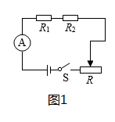
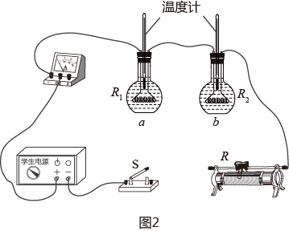

# Physics - 题目 2164

**ID**: 190053a4ce0b44379a4a9e573f75e6d9
**年级**: Grade 9
**难度**: Medium-Hard
**题型**: Experiment

## 题目
在“探究电流产生的热量与哪些因素有关”的实验中，实验电路如图1所示，其中R_{1}>R_{2}。​​​​​​​‌实验一：探究电流产生的热量与电阻大小的关系；（1）请按照图1中的电路图将图2实物图连接完整；（2）实验电路按照图1中的电路图连接是为了控制通电时间相同和控制；电阻丝放出热量的多少，通过来进行判断。（3）为了便于比较两根电阻丝通过电流后产生热量的多少，a、b两瓶中要装入相等、初温相同的同种液体。为了在较短时间内达到明显的实验效果，实验时选用煤油而不选水，是因为煤油的比热容水的比热容（选填“大于”、“等于”或“小于”）；实验二：探究电流产生的热量与电流大小的关系（4）闭合开关，移动滑动变阻器的滑片，使电路中的电流变成实验一中电流的2倍，且通电时间相同。实验发现：用电阻丝R_{1}加热的煤油，在实验一中温度升高Δt_{1}，在实验二中温度升高Δt_{1}′，则Δt_{1}′2Δt_{1}（选填“大于”、“等于”或“小于”），该实验说明电流产生的热量与电流大小正比例关系（选填“成”或“不成”）。实验中，用电阻丝R_{2}加热煤油重复以上实验步骤，也可以得出相同的结论。（5）如果在两烧瓶中分别装入质量相等的不同液体，并接入两根阻值的电阻丝（选填“相同”或“不同”），就可用这个装置来探究两种不同液体的吸热性质。假设a烧瓶中液体的质量为m，瓶中电阻丝的阻值为R，测出通过它的电流为I，通电一段时间t后，温度计的示数变化量为Δt，若不计热量损失，则a液体的比热容为（用所给出的物理量写出比热容的表达式）。

## 解答

1. （1）[1]变阻器一上一下串联接入电路中，如图所示：
2. 
3. （2）[2]图1中，两个电阻丝串联，通过它们的电流相等，通电时间相等。
4. [3]根据转换法知，电阻丝放出热量的多少，是通过温度计的示数变化来进行判断的。
5. （3）[4]为了便于比较两种电阻丝通过电流后产生热量的多少，甲乙两瓶中要装入质量相同、初温相同的同种液体。
6. [5]因煤油比水具有较小的比热容，故用煤油比用水更容易看出温度的变化。
7. （4）[6][7]闭合开关，移动滑动变阻器的滑片，使电路中的电流变成实验一中电流的2倍，且通电时间相同，根据Q=I^{2}Rt可知，电阻丝产生的热量是原来的4倍；所以用电阻丝R_{1}加热的煤油，温度升高Δt_{1}′大于2Δt_{1}，该实验说明电流产生的热量与电流不是正比例关系。
8. （5）[8]在两烧瓶中分别装入质量相等的不同液体，并接入两根阻值相等的电阻丝，可以探究两种不同液体的吸热性质。
9. [9]电阻丝产生的热量Q=I^{2}Rt，不计热量损失，液体吸收的热量
10. Q_{吸}=Q=cmΔt
11. 则
12. c= $\frac {Q}{mΔt}=\frac {I{^{2}}Rt}{mΔt}$

## 知识点

**中文**:
  - 影响电流热效应因素的探究实验

**English**:
  - Experiment: Factors Affecting Heating Effect

---
