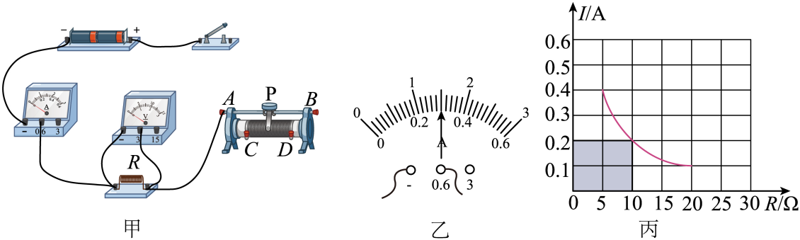

# Physics - 题目 1026

**ID**: 1af78f357a4840f9b226496a06330a64
**年级**: Grade 9
**难度**: Medium-Hard
**题型**: Experiment

## 题目
小华用如图甲所示装置探究电流与电压的关系，电源电压3V恒定不变，滑动变阻器的规格为“30Ω2A”。​​​​​​​‌（1）请用笔画线代替导线，在图甲中完成电路连接，要求滑片P到右滑动时，电流表的示数变小；（2）连接好电路后闭合开关，移动滑片，发现电流表完示数，电压表有示数，期出现该故障的原因可能是。（3）排除故障后，改变滑片位置，记录实验数据如下表，空格处的电流如图乙所承，读数是A，根据表中数据可归纳得出结论：。电压U/V0.51.01.52.02.53.0电流I/A0.10.20.40.50.6（4）为了进一步探究电流与电阻的关系，小华又找来10Ω、15Ω、20Ω的定值电阻继续实验。①将滑动变阻器的滑片置于阻值最大处，闭合开类，缓慢移动凝片，直至电压表示数为上表，接下来用10Ω的电阻替换原电阻，应将滑片向（选填“左”或“右”）滑动，使电压表示数仍为1V，记录电流表示数，再将15Ω、20Ω的定值电阻分别接入电路，重复以上步骤；②当将20Ω的电阻接入电路进行实验时，发现无论如何调节滑片都无法满足预设电压为1V的条件。为使该屯阻也能完成实验，小华认为可以改变电压表的预设电压，该预设值应不低于V；他们重新预设电压进行实验，根据记录的数据绘制成图丙所示的图象，由此可得出结论；当导体两端电属一定时，通过导体的电流与电阻成。

## 解答

1. （1）要求滑片P向右滑动时，电流表的示数变小，即滑动变阻器接入电路的阻值变大，所以，应把滑动变阻器的左下接线柱接入电路，电路连接如图：
2. 
3. （2）电流表无示数，说明电路可能断路了，电压表有示数，则电压表和电源形成的回路没有断路，所以是与电压表并联定值电阻发生了断路。
4. （3）电流表的量程为0～0.6A，分度值为0.02A，该示数为0.30A，根据表中数据可知，电压与电流的比值不变，即 $R=\frac {U}{I}=\frac {0.5{\rm{V}}}{0.1{\rm{A}}}=\frac {1.0{\rm{V}}}{0.2{\rm{A}}}=\frac {1.5{\rm{V}}}{0.3{\rm{A}}}=\frac {2.0{\rm{V}}}{0.4{\rm{A}}}=\frac {2.5{\rm{V}}}{0.5{\rm{A}}}=\frac {3.0{\rm{V}}}{0.6{\rm{A}}}=5{\rm{Ω}}$ ，所以，可得结论：电阻一定时，电流跟电压成正比。
5. （4）①探究电流与电阻的关系时，应控制定值电阻两端的电压不变，将5Ω的定值电阻换成10Ω的定值电阻时，定值电阻两端的电压变大，根据串联电路的分压特点可知，应增大滑动变阻器接入电路的阻值，即滑片向右移动，使电压表的示数仍为1V。②原来接入的电阻为5Ω，电压表示数为1V，即U_{R}=1V，由串联分压可知U_{滑}=U_{总}-U_{R}=3V-1V=2V，由于串联电路中，各串联导体起分担电压的作用，电压之比等于电阻之比 $\frac {U{{}_{{\rm{R}}}}}{U{{}_{滑}}}=\frac {R}{R{{}_{滑}}}；\frac {1{\rm{V}}}{3{\rm{V}}-1{\rm{V}}}=\frac {20{\rm{Ω}}}{R{{}_{滑}}}，解得：R{{}_{滑}}=40{\rm{Ω}}$ ，滑动变阻器需要40Ω，才能控制定值电阻两端的电压为1V，此实验中滑动变阻器的规格是“30Ω 2A”，所以不能完成实验。把滑动变阻器的最大阻值30Ω接入电路时，定值电阻两端的电压即为电压表的预设最小电压。把滑动变阻器的最大阻值30Ω接入电路时，电路中的电流最小为 $I{{}_{最小}}=\frac {U}{R+R{{}_{滑}}}=\frac {3{\rm{V}}}{20{\rm{Ω}}+30{\rm{Ω}}}=0.06{\rm{A}}$ ，
6. 电压表的预设最小电压为U_{最小}=I_{最小}R=0.06A×20Ω=1.2V，根据图像可知，电流跟电阻的乘积不变，得到的实验结论：在电压一定时，电流跟电阻成反比。

## 知识点

**中文**:
  - 电流与电压关系的探究实验
  - 电流与电阻关系的探究实验

**English**:
  - Experiment: Relationship between Current and Voltage
  - Experiment: Relationship between Current and Resistance

---
